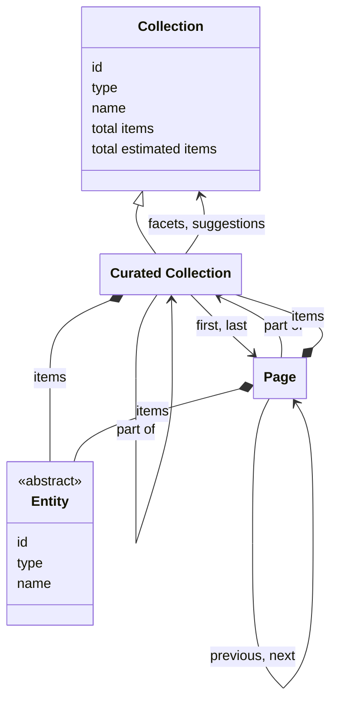

# Curated collections

## Introduction

A curated collection is a grouping of [entities](entities.md). It is the main way for a presentation layer to browse and filter the entities of an integration layer. An integration layer can include any entity of any type in a curated collection, and can create any number of curated collections, nested in any way, depending on the requirements of presentation layers. An entity can be a part of any number of collections, and of no collection at all. A collection is a selection, not a type.

For example: an integration layer may have a collection for all entities of type 'Heritage object'. The integration layer may also have a 'Masterpieces' collection with its finest art-related entities, and a 'Paintings from the 17th century' collection; 'The Night Watch' can be a part of both. The integration layer may also have a 'Great for kids' collection with entities that are interesting for children. The integration layer decides how the entities are selected and put into a collection: entities may be hand-picked, derived by a query, or assembled by aggregating other collections.

An integration layer may add extra functionality to a curated collection. For example: users of a presentation layer may want to find entities in the 'Masterpieces' collection using faceted search or users may want to get suggestions to find entities in the 'Great for kids' collection using autocompletion. This specification defines two optional functionalities: [facets](facets.md) and [suggestions](suggestions.md).

## Data model

| Name               | Description                                                                                                                              |
| ------------------ | ---------------------------------------------------------------------------------------------------------------------------------------- |
| Collection         | An ordered list of resources. See [Resources](resources.md).                                                                             |
| Curated Collection | An ordered list of entities or further curated collections. It may consist of pages, containing sublists of the items in the collection. |
| Page               | An ordered sublist of the items in a curated collection.                                                                                 |
| Entity             | An identifiable 'thing' relevant to heritage. See [Entities](entities.md).                                                               |

The following class diagram visualises the data model:



## Endpoint: Retrieve the root collection

The endpoint retrieves the root collection: the curated collection that is not a part of another collection. Its items are curated collections, entities, or a mixture of both. The integration layer _MUST_ implement this endpoint, even if the root collection is the only collection it offers: an integration layer that does not nest its collections offers its entities as the items of the root collection.

The root collection is the entry point into the API: it allows a presentation layer to identify the collections and entities the integration layer offers, and their endpoint URIs. An integration layer exposes its root at URI `/{version}/collections`, so that a presentation layer can assume where the tree begins. It's up to the integration layer to define what the tree holds and how the collections are nested.

### HTTP request

`GET /{version}/collections`

### Path parameters

| Name      | Data type | Cardinality | Description                            |
| --------- | --------- | ----------- | -------------------------------------- |
| `version` | string    | 1           | The version of the API. Example: `v1`. |

### Query parameters

None.

### Request body

None.

### Response body

The response body _MUST_ contain at least the following properties:

| Name                  | Data type                 | Cardinality | Description                                                                                                                                                                                                                                                                              |
| --------------------- | ------------------------- | ----------- | ---------------------------------------------------------------------------------------------------------------------------------------------------------------------------------------------------------------------------------------------------------------------------------------- |
| `@context`            | string                    | 1           | The URI of the JSON-LD context that maps the terms in the response to URIs.                                                                                                                                                                                                              |
| `id`                  | string                    | 1           | The identifier of the collection.                                                                                                                                                                                                                                                        |
| `type`                | string                    | 1           | The type of the collection. It _MUST_ be `CuratedCollection` or a specialisation.                                                                                                                                                                                                        |
| `name`                | string                    | 1           | The name of the collection.                                                                                                                                                                                                                                                              |
| `totalItems`          | number                    | 0 or 1      | The exact total number of items in the collection, being its further collections, its entities, or both. Not set if the exact total is too costly to calculate. Mutually exclusive with `estimatedTotalItems`.                                                                           |
| `estimatedTotalItems` | number                    | 0 or 1      | An estimate of the total number of items in the collection. It can be higher or lower than the real total. Not set if there is no estimate. Mutually exclusive with `totalItems`.                                                                                                        |
| `items`               | array                     | 0 or 1      | A list of the items in the collection. Not set if the collection is divided into [pages](#endpoint-retrieve-a-page-in-a-collection); the items of the first page are in `first`.                                                                                                         |
| `items[*]`            | CuratedCollection, Entity | 1           | A `CuratedCollection` or a specialisation, or a specialisation of `Entity`.                                                                                                                                                                                                              |
| `pageUriTemplate`     | string                    | 0 or 1      | A [URI template](https://www.rfc-editor.org/rfc/rfc6570.html) for the pages of the collection. It contains the `page` variable. Set only if the collection is divided into pages that can be addressed by number. See [Pagination](resources.md#pagination).                             |
| `first`               | Page                      | 0 or 1      | The first page in the collection, including its items and links. It has the properties of a [Page](#endpoint-retrieve-a-page-in-a-collection), except `partOf`. Not set if the collection is empty or if it is not divided into pages.                                                   |
| `first.id`            | string                    | 1           | The identifier of the first page in the collection.                                                                                                                                                                                                                                      |
| `first.type`          | string                    | 1           | The type of the first page in the collection. It _MUST_ be `Page` or a specialisation.                                                                                                                                                                                                   |
| `first.name`          | string                    | 1           | The name of the first page.                                                                                                                                                                                                                                                              |
| `first.items`         | array                     | 1           | The items of the first page. A first page always has at least one item.                                                                                                                                                                                                                  |
| `first.items[*]`      | CuratedCollection, Entity | 1           | A `CuratedCollection` or a specialisation, or a specialisation of `Entity`.                                                                                                                                                                                                              |
| `first.next`          | Page                      | 0 or 1      | The page after the first page. Not set if there is no next page.                                                                                                                                                                                                                         |
| `first.next.id`       | string                    | 1           | The identifier of the next page.                                                                                                                                                                                                                                                         |
| `first.next.type`     | string                    | 1           | The type of the next page. It _MUST_ be `Page` or a specialisation.                                                                                                                                                                                                                      |
| `last`                | Page                      | 0 or 1      | The last page in the collection. Not set if the collection is empty, if the collection is not divided into [pages](#endpoint-retrieve-a-page-in-a-collection), or if the last page is unknown (e.g. in case of [cursor navigation](resources.md#page-navigation-and-cursor-navigation)). |
| `last.id`             | string                    | 1           | The identifier of the last page in the collection.                                                                                                                                                                                                                                       |
| `last.type`           | string                    | 1           | The type of the last page in the collection. It _MUST_ be `Page` or a specialisation.                                                                                                                                                                                                    |
| `capabilities`        | array                     | 0 or 1      | The URIs of the capabilities the integration layer implements for this collection. It _MUST_ be omitted if the collection supports no capabilities. See [Capability discovery](resources.md#capability-discovery).                                                                       |
| `facets`              | Collection                | 0 or 1      | The list of this collection's facet collections. _MUST_ be omitted if the collection has no facet collections. See [Facets](facets.md).                                                                                                                                                  |
| `facets.id`           | string                    | 1           | The identifier of the list.                                                                                                                                                                                                                                                              |
| `facets.type`         | string                    | 1           | The type of the list. It _MUST_ be `Collection` or a specialisation.                                                                                                                                                                                                                     |
| `facets.name`         | string                    | 1           | The name of the list.                                                                                                                                                                                                                                                                    |
| `suggestions`         | Collection                | 0 or 1      | The list of this collection's suggestion collections. _MUST_ be omitted if the collection has no suggestion collections. See [Suggestions](suggestions.md).                                                                                                                              |
| `suggestions.id`      | string                    | 1           | The identifier of the list.                                                                                                                                                                                                                                                              |
| `suggestions.type`    | string                    | 1           | The type of the list. It _MUST_ be `Collection` or a specialisation.                                                                                                                                                                                                                     |
| `suggestions.name`    | string                    | 1           | The name of the list.                                                                                                                                                                                                                                                                    |
| `queryables`          | object                    | 0 or 1      | The Queryables resource of this collection. It lists the properties that can be used in a filter. A collection that advertises the `advanced-search` capability _MUST_ set it. See [Queryables](search.md#queryables).                                                                   |
| `queryables.id`       | string                    | 1           | The identifier of the Queryables resource.                                                                                                                                                                                                                                               |

Note: the response body carries no `partOf` property — the root collection is not a part of another collection.

### Example

An example of the response body of the integration layer:

```json
{
  "@context": "https://example.org/v1/context.json",
  "id": "https://example.org/v1/collections",
  "type": "CuratedCollection",
  "name": "Collections",
  "totalItems": 3,
  "items": [
    {
      "id": "https://example.org/v1/collections/objects",
      "type": "CuratedCollection",
      "name": "Heritage objects"
    },
    {
      "id": "https://example.org/v1/collections/masterpieces",
      "type": "CuratedCollection",
      "name": "Masterpieces"
    },
    {
      "id": "https://example.org/v1/collections/persons",
      "type": "CuratedCollection",
      "name": "Persons"
    }
  ]
}
```

The response indicates that the integration layer has three collections that are a part of the root collection.

## Endpoint: Retrieve a collection

The endpoint retrieves a curated collection. The integration layer _MAY_ implement this endpoint, for the collections it chooses to expose.

### HTTP request

`GET /{version}/collections(/{...collections})/{collection}`

### Path parameters

| Name             | Data type | Cardinality | Description                                                                                |
| ---------------- | --------- | ----------- | ------------------------------------------------------------------------------------------ |
| `version`        | string    | 1           | The version of the API. Example: `v1`.                                                     |
| `...collections` | string    | 0 or more   | The path identifier(s) of the collection(s) the collection is part of. Example: `persons`. |
| `collection`     | string    | 1           | The path identifier of the collection. Example: `masterpieces`, `objects`.                 |

### Query parameters

| Name      | Data type | Cardinality | Description                                                                                                                                                                                                                                                                                                                                                                                                                                                                                                                                        |
| --------- | --------- | ----------- | -------------------------------------------------------------------------------------------------------------------------------------------------------------------------------------------------------------------------------------------------------------------------------------------------------------------------------------------------------------------------------------------------------------------------------------------------------------------------------------------------------------------------------------------------- |
| `q`       | string    | 0 or 1      | A keyword query for filtering the items. The integration layer defines the minimum and maximum length and how the query is matched. Mutually exclusive with `search`.                                                                                                                                                                                                                                                                                                                                                                              |
| `size`    | number    | 0 or 1      | The maximum number of items to retrieve. The minimum is 1. The integration layer defines the maximum. Mutually exclusive with `search`.                                                                                                                                                                                                                                                                                                                                                                                                            |
| `orderBy` | string    | 0 or 1      | The sorting order of the items: a comma-separated list of sort criteria, in priority order. Each criterion is `property` or `property:order`, where `property` is `relevance` or `value` and `order` is `asc` or `desc`. The integration layer defines the default order and which property `value` sorts on (e.g. the `name` of the item). `relevance` typically expresses how well an item matches the keyword query (`q`). An integration layer _MAY_ also apply its own relevance rules when `q` is missing. Mutually exclusive with `search`. |
| `search`  | string    | 0 or 1      | An identifier for an [advanced search](search.md#endpoint-advanced-search). Mutually exclusive with `q`, `size` and `orderBy`.                                                                                                                                                                                                                                                                                                                                                                                                                     |

### Request body

None.

### Response body

The response body _MUST_ contain at least the following properties:

| Name                  | Data type                 | Cardinality | Description                                                                                                                                                                                                                                                                              |
| --------------------- | ------------------------- | ----------- | ---------------------------------------------------------------------------------------------------------------------------------------------------------------------------------------------------------------------------------------------------------------------------------------- |
| `@context`            | string                    | 1           | The URI of the JSON-LD context that maps the terms in the response to URIs.                                                                                                                                                                                                              |
| `id`                  | string                    | 1           | The identifier of the collection.                                                                                                                                                                                                                                                        |
| `type`                | string                    | 1           | The type of the collection. It _MUST_ be `CuratedCollection` or a specialisation.                                                                                                                                                                                                        |
| `name`                | string                    | 1           | The name of the collection.                                                                                                                                                                                                                                                              |
| `totalItems`          | number                    | 0 or 1      | The exact total number of items in the collection, being its further collections, its entities, or both. Not set if the exact total is too costly to calculate. Mutually exclusive with `estimatedTotalItems`.                                                                           |
| `estimatedTotalItems` | number                    | 0 or 1      | An estimate of the total number of items in the collection. It can be higher or lower than the real total. Not set if there is no estimate. Mutually exclusive with `totalItems`.                                                                                                        |
| `items`               | array                     | 0 or 1      | A list of the items in the collection. Not set if the collection is divided into [pages](#endpoint-retrieve-a-page-in-a-collection); the items of the first page are in `first`.                                                                                                         |
| `items[*]`            | CuratedCollection, Entity | 1           | A `CuratedCollection` or a specialisation, or a specialisation of `Entity`.                                                                                                                                                                                                              |
| `pageUriTemplate`     | string                    | 0 or 1      | A [URI template](https://www.rfc-editor.org/rfc/rfc6570.html) for the pages of the collection. It contains the `page` variable. Set only if the collection is divided into pages that can be addressed by number. See [Pagination](resources.md#pagination).                             |
| `first`               | Page                      | 0 or 1      | The first page in the collection, including its items and links. It has the properties of a [Page](#endpoint-retrieve-a-page-in-a-collection), except `partOf`. Not set if the collection is empty or if it is not divided into pages.                                                   |
| `first.id`            | string                    | 1           | The identifier of the first page in the collection.                                                                                                                                                                                                                                      |
| `first.type`          | string                    | 1           | The type of the first page in the collection. It _MUST_ be `Page` or a specialisation.                                                                                                                                                                                                   |
| `first.name`          | string                    | 1           | The name of the first page.                                                                                                                                                                                                                                                              |
| `first.items`         | array                     | 1           | The items of the first page. A first page always has at least one item.                                                                                                                                                                                                                  |
| `first.items[*]`      | CuratedCollection, Entity | 1           | A `CuratedCollection` or a specialisation, or a specialisation of `Entity`.                                                                                                                                                                                                              |
| `first.next`          | Page                      | 0 or 1      | The page after the first page. Not set if there is no next page.                                                                                                                                                                                                                         |
| `first.next.id`       | string                    | 1           | The identifier of the next page.                                                                                                                                                                                                                                                         |
| `first.next.type`     | string                    | 1           | The type of the next page. It _MUST_ be `Page` or a specialisation.                                                                                                                                                                                                                      |
| `last`                | Page                      | 0 or 1      | The last page in the collection. Not set if the collection is empty, if the collection is not divided into [pages](#endpoint-retrieve-a-page-in-a-collection), or if the last page is unknown (e.g. in case of [cursor navigation](resources.md#page-navigation-and-cursor-navigation)). |
| `last.id`             | string                    | 1           | The identifier of the last page in the collection.                                                                                                                                                                                                                                       |
| `last.type`           | string                    | 1           | The type of the last page in the collection. It _MUST_ be `Page` or a specialisation.                                                                                                                                                                                                    |
| `partOf`              | CuratedCollection         | 0 or 1      | The collection of which this collection is a part. Not set if this collection is the [root collection](#endpoint-retrieve-the-root-collection).                                                                                                                                          |
| `partOf.id`           | string                    | 1           | The identifier of the collection.                                                                                                                                                                                                                                                        |
| `partOf.type`         | string                    | 1           | The type of the collection. It _MUST_ be `CuratedCollection` or a specialisation.                                                                                                                                                                                                        |
| `partOf.name`         | string                    | 1           | The name of the collection.                                                                                                                                                                                                                                                              |
| `capabilities`        | array                     | 0 or 1      | The URIs of the capabilities the integration layer implements for this collection. It _MUST_ be omitted if the collection supports no capabilities. See [Capability discovery](resources.md#capability-discovery).                                                                       |
| `facets`              | Collection                | 0 or 1      | The list of this collection's facet collections. _MUST_ be omitted if the collection has no facet collections. See [Facets](facets.md).                                                                                                                                                  |
| `facets.id`           | string                    | 1           | The identifier of the list.                                                                                                                                                                                                                                                              |
| `facets.type`         | string                    | 1           | The type of the list. It _MUST_ be `Collection` or a specialisation.                                                                                                                                                                                                                     |
| `facets.name`         | string                    | 1           | The name of the list.                                                                                                                                                                                                                                                                    |
| `suggestions`         | Collection                | 0 or 1      | The list of this collection's suggestion collections. _MUST_ be omitted if the collection has no suggestion collections. See [Suggestions](suggestions.md).                                                                                                                              |
| `suggestions.id`      | string                    | 1           | The identifier of the list.                                                                                                                                                                                                                                                              |
| `suggestions.type`    | string                    | 1           | The type of the list. It _MUST_ be `Collection` or a specialisation.                                                                                                                                                                                                                     |
| `suggestions.name`    | string                    | 1           | The name of the list.                                                                                                                                                                                                                                                                    |
| `queryables`          | object                    | 0 or 1      | The Queryables resource of this collection. It lists the properties that can be used in a filter. A collection that advertises the `advanced-search` capability _MUST_ set it. See [Queryables](search.md#queryables).                                                                   |
| `queryables.id`       | string                    | 1           | The identifier of the Queryables resource.                                                                                                                                                                                                                                               |

### Example

An example of the response body of a collection that holds further collections:

```json
{
  "@context": "https://example.org/v1/context.json",
  "id": "https://example.org/v1/collections/persons",
  "type": "CuratedCollection",
  "name": "Persons",
  "totalItems": 2,
  "items": [
    {
      "id": "https://example.org/v1/collections/persons/painters",
      "type": "CuratedCollection",
      "name": "Painters"
    },
    {
      "id": "https://example.org/v1/collections/persons/writers",
      "type": "CuratedCollection",
      "name": "Writers"
    }
  ],
  "partOf": {
    "id": "https://example.org/v1/collections",
    "type": "CuratedCollection",
    "name": "Collections"
  }
}
```

The response indicates that the 'Persons' collection groups two collections: one for 'Painters' and one for 'Writers'. The collection itself is a part of a parent collection, 'Collections'.

An example of the response body of a collection that is divided into pages:

```json
{
  "@context": "https://example.org/v1/context.json",
  "id": "https://example.org/v1/collections/objects",
  "type": "CuratedCollection",
  "name": "Heritage objects",
  "totalItems": 195,
  "pageUriTemplate": "https://example.org/v1/collections/objects{?page}",
  "first": {
    "id": "https://example.org/v1/collections/objects?page=1",
    "type": "Page",
    "name": "Heritage objects: page 1",
    "items": [
      {
        "id": "https://example.org/v1/entities/1234",
        "type": "HeritageObject",
        "name": "The Night Watch"
      }
      // Other items...
    ],
    "next": {
      "id": "https://example.org/v1/collections/objects?page=2",
      "type": "Page"
    }
  },
  "last": {
    "id": "https://example.org/v1/collections/objects?page=20",
    "type": "Page"
  },
  "partOf": {
    "id": "https://example.org/v1/collections",
    "type": "CuratedCollection",
    "name": "Collections"
  }
}
```

The response indicates that this collection contains 195 entities, spread over 20 pages, and that its pages can be addressed by number. It includes the first page in `first`, with its items and a link to the next page.

An example of the response body of a collection with extended capabilities:

```json
{
  "@context": "https://example.org/v1/context.json",
  "id": "https://example.org/v1/collections/masterpieces",
  "type": "CuratedCollection",
  "name": "Masterpieces",
  "totalItems": 195,
  "pageUriTemplate": "https://example.org/v1/collections/masterpieces{?page}",
  "first": {
    "id": "https://example.org/v1/collections/masterpieces?page=1",
    "type": "Page",
    "name": "Masterpieces: page 1",
    "items": [
      {
        "id": "https://example.org/v1/entities/1234",
        "type": "HeritageObject",
        "name": "The Night Watch"
      }
      // Other items...
    ],
    "next": {
      "id": "https://example.org/v1/collections/masterpieces?page=2",
      "type": "Page"
    }
  },
  "last": {
    "id": "https://example.org/v1/collections/masterpieces?page=20",
    "type": "Page"
  },
  "partOf": {
    "id": "https://example.org/v1/collections",
    "type": "CuratedCollection",
    "name": "Collections"
  },
  "capabilities": [
    "https://specs.nde.nl/rest/v1/simple-search",
    "https://specs.nde.nl/rest/v1/advanced-search",
    "https://specs.nde.nl/rest/v1/facets",
    "https://specs.nde.nl/rest/v1/suggestions"
  ],
  "facets": {
    "id": "https://example.org/v1/collections/masterpieces/facets",
    "type": "Collection",
    "name": "Facets"
  },
  "suggestions": {
    "id": "https://example.org/v1/collections/masterpieces/suggestions",
    "type": "Collection",
    "name": "Suggestions"
  },
  "queryables": {
    "id": "https://example.org/v1/collections/masterpieces/queryables"
  }
}
```

The response indicates that this collection supports simple search, advanced search, facets and suggestions, and that its pages can be addressed by number. It includes the first page in `first`.

## Endpoint: Retrieve a page in a collection

The endpoint retrieves a page in a curated collection. The integration layer _MUST_ implement this endpoint for every collection it divides into [pages](#endpoint-retrieve-a-page-in-a-collection).

### HTTP request

`GET /{version}/collections(/{...collections})/{collection}?page={page}`

### Path parameters

| Name             | Data type | Cardinality | Description                                                                                |
| ---------------- | --------- | ----------- | ------------------------------------------------------------------------------------------ |
| `version`        | string    | 1           | The version of the API. Example: `v1`.                                                     |
| `...collections` | string    | 0 or more   | The path identifier(s) of the collection(s) the collection is part of. Example: `persons`. |
| `collection`     | string    | 1           | The path identifier of the collection. Example: `masterpieces`, `objects`.                 |

### Query parameters

| Name      | Data type | Cardinality | Description                                                                                                                                                                                                                                                                                                                                                                                                                                                                                                                                        |
| --------- | --------- | ----------- | -------------------------------------------------------------------------------------------------------------------------------------------------------------------------------------------------------------------------------------------------------------------------------------------------------------------------------------------------------------------------------------------------------------------------------------------------------------------------------------------------------------------------------------------------- |
| `page`    | string    | 1           | The page to retrieve. If the collection has a [`pageUriTemplate`](resources.md#collection), the value is a page number. Otherwise it is a cursor that the integration layer returned in a page URI. See [Pagination](resources.md#page-navigation-and-cursor-navigation).                                                                                                                                                                                                                                                                          |
| `q`       | string    | 0 or 1      | A keyword query for filtering the items. The integration layer defines the minimum and maximum length and how the query is matched. Mutually exclusive with `search`.                                                                                                                                                                                                                                                                                                                                                                              |
| `size`    | number    | 0 or 1      | The maximum number of items to retrieve. The minimum is 1. The integration layer defines the maximum. Mutually exclusive with `search`.                                                                                                                                                                                                                                                                                                                                                                                                            |
| `orderBy` | string    | 0 or 1      | The sorting order of the items: a comma-separated list of sort criteria, in priority order. Each criterion is `property` or `property:order`, where `property` is `relevance` or `value` and `order` is `asc` or `desc`. The integration layer defines the default order and which property `value` sorts on (e.g. the `name` of the item). `relevance` typically expresses how well an item matches the keyword query (`q`). An integration layer _MAY_ also apply its own relevance rules when `q` is missing. Mutually exclusive with `search`. |
| `search`  | string    | 0 or 1      | An identifier for an [advanced search](search.md#endpoint-advanced-search). Mutually exclusive with `q`, `size` and `orderBy`.                                                                                                                                                                                                                                                                                                                                                                                                                     |

### Request body

None.

### Response body

The response body _MUST_ contain at least the following properties:

| Name                         | Data type                  | Cardinality | Description                                                                                                                                                                                                                                                                                                                                                                                      |
| ---------------------------- | -------------------------- | ----------- | ------------------------------------------------------------------------------------------------------------------------------------------------------------------------------------------------------------------------------------------------------------------------------------------------------------------------------------------------------------------------------------------------ |
| `@context`                   | string                     | 1           | The URI of the JSON-LD context that maps the terms in the response to URIs.                                                                                                                                                                                                                                                                                                                      |
| `id`                         | string                     | 1           | The identifier of the current page.                                                                                                                                                                                                                                                                                                                                                              |
| `type`                       | string                     | 1           | The type of the page. It _MUST_ be `Page` or a specialisation.                                                                                                                                                                                                                                                                                                                                   |
| `name`                       | string                     | 1           | The name of the page.                                                                                                                                                                                                                                                                                                                                                                            |
| `items`                      | array                      | 1           | A list of the items in the collection that fall on this page.                                                                                                                                                                                                                                                                                                                                    |
| `items[*]`                   | CuratedCollection, Entity  | 1           | A `CuratedCollection` or a specialisation, or a specialisation of `Entity`. If an `Entity`: all properties _MUST_ be embedded — see the response body of endpoint [Retrieve an entity](entities.md#endpoint-retrieve-an-entity).                                                                                                                                                                 |
| `facets`                     | array                      | 0 or 1      | The facet results requested via the `facet` query parameters. _MUST_ be omitted if no facets were requested. See [Facets on a page](#facets-on-a-page).                                                                                                                                                                                                                                          |
| `facets[*]`                  | FacetCollection, FacetPage | 1           | The result of one requested facet. It is a `FacetPage` if the facet collection is divided into [pages](resources.md#page), and a `FacetCollection` if it is not. The result is the response body of endpoint [Retrieve a facet collection](facets.md#endpoint-retrieve-a-facet-collection) or [Retrieve a page in a facet collection](facets.md#endpoint-retrieve-a-page-in-a-facet-collection). |
| `prev`                       | Page                       | 0 or 1      | The previous page in the collection. Not set if there is no previous page.                                                                                                                                                                                                                                                                                                                       |
| `prev.id`                    | string                     | 1           | The identifier of the previous page in the collection.                                                                                                                                                                                                                                                                                                                                           |
| `prev.type`                  | string                     | 1           | The type of the previous page in the collection. It _MUST_ be `Page` or a specialisation.                                                                                                                                                                                                                                                                                                        |
| `next`                       | Page                       | 0 or 1      | The next page in the collection. Not set if there is no next page.                                                                                                                                                                                                                                                                                                                               |
| `next.id`                    | string                     | 1           | The identifier of the next page in the collection.                                                                                                                                                                                                                                                                                                                                               |
| `next.type`                  | string                     | 1           | The type of the next page in the collection. It _MUST_ be `Page` or a specialisation.                                                                                                                                                                                                                                                                                                            |
| `partOf`                     | CuratedCollection          | 0 or 1      | The collection to which the items contained by the page belong. It _MUST_ be set unless the page is embedded in the `first` property of its collection: the collection that contains it is the collection it belongs to.                                                                                                                                                                         |
| `partOf.id`                  | string                     | 1           | The identifier of the collection.                                                                                                                                                                                                                                                                                                                                                                |
| `partOf.type`                | string                     | 1           | The type of the collection. It _MUST_ be `CuratedCollection` or a specialisation.                                                                                                                                                                                                                                                                                                                |
| `partOf.name`                | string                     | 1           | The name of the collection.                                                                                                                                                                                                                                                                                                                                                                      |
| `partOf.totalItems`          | number                     | 0 or 1      | The exact total number of items in the collection, being its further collections, its resources, or both. Not set if the exact total is too costly to calculate. Mutually exclusive with `partOf.estimatedTotalItems`.                                                                                                                                                                           |
| `partOf.estimatedTotalItems` | number                     | 0 or 1      | An estimate of the total number of items in the collection. It can be higher or lower than the real total. Not set if there is no estimate. Mutually exclusive with `partOf.totalItems`.                                                                                                                                                                                                         |
| `partOf.pageUriTemplate`     | string                     | 0 or 1      | A [URI template](https://www.rfc-editor.org/rfc/rfc6570.html) for the pages of the collection. It contains the `page` variable. Set only if the pages can be addressed by number. See [Pagination](resources.md#pagination).                                                                                                                                                                     |
| `partOf.first`               | Page                       | 1           | A reference to the first page in the collection.                                                                                                                                                                                                                                                                                                                                                 |
| `partOf.first.id`            | string                     | 1           | The identifier of the first page in the collection.                                                                                                                                                                                                                                                                                                                                              |
| `partOf.first.type`          | string                     | 1           | The type of the first page in the collection. It _MUST_ be `Page` or a specialisation.                                                                                                                                                                                                                                                                                                           |
| `partOf.last`                | Page                       | 0 or 1      | The last page in the collection. Not set if the last page is unknown (e.g. in case of [cursor navigation](resources.md#page-navigation-and-cursor-navigation)).                                                                                                                                                                                                                                  |
| `partOf.last.id`             | string                     | 1           | The identifier of the last page in the collection.                                                                                                                                                                                                                                                                                                                                               |
| `partOf.last.type`           | string                     | 1           | The type of the last page in the collection. It _MUST_ be `Page` or a specialisation.                                                                                                                                                                                                                                                                                                            |

### Example

An example of the response body:

```json
{
  "@context": "https://example.org/v1/context.json",
  "id": "https://example.org/v1/collections/masterpieces?page=3",
  "type": "Page",
  "name": "Masterpieces: page 3",
  "items": [
    {
      "id": "https://example.org/v1/entities/1234",
      "type": "HeritageObject",
      "name": "The Night Watch"
    }
    // Other items...
  ],
  "prev": {
    "id": "https://example.org/v1/collections/masterpieces?page=2",
    "type": "Page"
  },
  "next": {
    "id": "https://example.org/v1/collections/masterpieces?page=4",
    "type": "Page"
  },
  "partOf": {
    "id": "https://example.org/v1/collections/masterpieces",
    "type": "CuratedCollection",
    "name": "Masterpieces",
    "totalItems": 195,
    "pageUriTemplate": "https://example.org/v1/collections/masterpieces{?page}",
    "first": {
      "id": "https://example.org/v1/collections/masterpieces?page=1",
      "type": "Page"
    },
    "last": {
      "id": "https://example.org/v1/collections/masterpieces?page=20",
      "type": "Page"
    }
  }
}
```

The response indicates that this page contains items (`items`), is related to a previous page (`prev`) and a next page (`next`) and its items are part of a collection (`partOf`). The `partOf` refers to the first page of the collection and, because the integration layer knows it, to the last page.

### Facets on a page

:::note To do

Refactor: facets will not be returned in a collection or page response anymore, only via a separate endpoint

:::

A page can carry the results of the facets that the presentation layer requested in a dedicated `facets` property.

An entry in the `facets` property mirrors the facet collection it belongs to. If that facet collection is divided into pages, the entry is a `FacetPage`. If it is not, the entry is the `FacetCollection` itself, which lists its facet items inline. A presentation layer therefore has to accept both shapes. It distinguishes them by the `type` of the entry.

Both shapes are allowed in one `facets` property. The API of an integration layer is easier to use, however, when all of its facet collections have the same shape. An integration layer _SHOULD_ therefore either divide all of its facet collections into pages, or divide none of them. Then every entry in `facets` has the same type, and a presentation layer can read all of them in one way.

The results in `facets` belong to the whole collection, not to one page. They depend on the query in the request, such as `q` and `filter`, and not on `page`. Every page of the same collection for the same query therefore carries the same facet results; only the `items` change when a presentation layer moves to the next page. A presentation layer can request the facets on the first page and reuse the results on the following pages.

A page response has two kinds of `next` and `prev` links. The links of the page itself move within the collection. The links inside an entry of `facets` move within the results of that facet. They are not the same, and a presentation layer must not confuse them.

The next two examples show the two shapes separately. Both are allowed, and an integration layer _MAY_ return either one.

#### Facets that are not divided into pages

An example of a response body in which the presentation layer requested two facet collections that are not divided into pages. Both entries in `facets` are a `FacetCollection`, which lists its items inline. A presentation layer reads every entry in the same way. An entry is the complete response body that the endpoint [Retrieve a facet collection](facets.md#endpoint-retrieve-a-facet-collection) returns. It has no `first` and no `last`, because a collection that is not divided into pages has no pages.

```json
{
  "@context": "https://example.org/v1/context.json",
  "id": "https://example.org/v1/collections/masterpieces?page=3",
  "type": "Page",
  "name": "Masterpieces: page 3",
  "items": [
    // Omitted for brevity; see the example response above
  ],
  "facets": [
    {
      "id": "https://example.org/v1/collections/masterpieces/facets/centuries?orderBy=count:desc&context=abc",
      "type": "FacetCollection",
      "name": "Made in century",
      "totalItems": 4,
      "items": [
        {
          "type": "FacetItem",
          "count": 8,
          "value": {
            "id": "https://example.org/v1/entities/3456",
            "type": "Concept",
            "name": "18th century"
          }
        },
        {
          "type": "FacetItem",
          "count": 5,
          "value": {
            "id": "https://example.org/v1/entities/3457",
            "type": "Concept",
            "name": "17th century"
          }
        },
        {
          "type": "FacetItem",
          "count": 3,
          "value": {
            "id": "https://example.org/v1/entities/3458",
            "type": "Concept",
            "name": "19th century"
          }
        },
        {
          "type": "FacetItem",
          "count": 1,
          "value": {
            "id": "https://example.org/v1/entities/3459",
            "type": "Concept",
            "name": "16th century"
          }
        }
      ],
      "partOf": {
        "id": "https://example.org/v1/collections/masterpieces/facets",
        "type": "Collection",
        "name": "Facets"
      }
    },
    {
      "id": "https://example.org/v1/collections/masterpieces/facets/subjects?orderBy=count:desc&context=abc",
      "type": "FacetCollection",
      "name": "Subject",
      "totalItems": 3,
      "items": [
        {
          "type": "FacetItem",
          "count": 8,
          "value": {
            "id": "https://example.org/v1/entities/4567",
            "type": "Concept",
            "name": "Religious art"
          }
        },
        {
          "type": "FacetItem",
          "count": 3,
          "value": {
            "id": "https://example.org/v1/entities/4568",
            "type": "Concept",
            "name": "Portraits"
          }
        },
        {
          "type": "FacetItem",
          "count": 1,
          "value": {
            "id": "https://example.org/v1/entities/4569",
            "type": "Concept",
            "name": "Prints"
          }
        }
      ],
      "partOf": {
        "id": "https://example.org/v1/collections/masterpieces/facets",
        "type": "Collection",
        "name": "Facets"
      }
    }
  ],
  "prev": {
    "id": "https://example.org/v1/collections/masterpieces?page=2",
    "type": "Page"
  },
  "next": {
    "id": "https://example.org/v1/collections/masterpieces?page=4",
    "type": "Page"
  },
  "partOf": {
    "id": "https://example.org/v1/collections/masterpieces",
    "type": "CuratedCollection",
    "name": "Masterpieces",
    "totalItems": 195,
    "pageUriTemplate": "https://example.org/v1/collections/masterpieces{?page}",
    "first": {
      "id": "https://example.org/v1/collections/masterpieces?page=1",
      "type": "Page"
    },
    "last": {
      "id": "https://example.org/v1/collections/masterpieces?page=20",
      "type": "Page"
    }
  }
}
```

#### Facets that are divided into pages

An example of a response body in which the presentation layer requested two facets collections that are divided into pages. Both entries in `facets` are a `FacetPage`. A presentation layer reads every entry in the same way, and follows the `next` property of an entry to see more values of that facet.

An entry is the complete response body of a `FacetPage`, the same body that the endpoint [Retrieve a page in a facet collection](facets.md#endpoint-retrieve-a-page-in-a-facet-collection) returns, including `prev` and `next`. The entries below have no `prev`, because they are the first page of their facet collection. Their `partOf` carries `totalItems`, `first` and `last`, so a presentation layer that wants a different page of that facet follows one of those.

```json
{
  "@context": "https://example.org/v1/context.json",
  "id": "https://example.org/v1/collections/objects?page=2",
  "type": "Page",
  "name": "Objects: page 2",
  "items": [
    // Omitted for brevity; see the example response above
  ],
  "facets": [
    {
      "id": "https://example.org/v1/collections/objects/facets/creators?page=1&size=3&orderBy=count:desc&context=abc",
      "type": "FacetPage",
      "name": "Creator: page 1",
      "items": [
        {
          "type": "FacetItem",
          "count": 12,
          "value": {
            "id": "https://example.org/v1/entities/7890",
            "type": "Person",
            "name": "Arno Haag"
          }
        },
        {
          "type": "FacetItem",
          "count": 8,
          "value": {
            "id": "https://example.org/v1/entities/7891",
            "type": "Person",
            "name": "Hans de Haan"
          }
        },
        {
          "type": "FacetItem",
          "count": 2,
          "value": {
            "id": "https://example.org/v1/entities/7892",
            "type": "Person",
            "name": "John Jansen"
          }
        }
      ],
      "next": {
        "id": "https://example.org/v1/collections/objects/facets/creators?page=2&size=3&orderBy=count:desc&context=abc",
        "type": "FacetPage"
      },
      "partOf": {
        "id": "https://example.org/v1/collections/objects/facets/creators",
        "type": "FacetCollection",
        "name": "Creator",
        "totalItems": 195,
        "first": {
          "id": "https://example.org/v1/collections/objects/facets/creators?page=1&size=3&orderBy=count:desc&context=abc",
          "type": "FacetPage"
        },
        "last": {
          "id": "https://example.org/v1/collections/objects/facets/creators?page=65&size=3&orderBy=count:desc&context=abc",
          "type": "FacetPage"
        }
      }
    },
    {
      "id": "https://example.org/v1/collections/objects/facets/places?page=1&size=3&orderBy=count:desc&context=abc",
      "type": "FacetPage",
      "name": "Made in place: page 1",
      "items": [
        {
          "type": "FacetItem",
          "count": 9,
          "value": {
            "id": "https://example.org/v1/entities/3450",
            "type": "Place",
            "name": "Amsterdam"
          }
        },
        {
          "type": "FacetItem",
          "count": 6,
          "value": {
            "id": "https://example.org/v1/entities/3451",
            "type": "Place",
            "name": "The Hague"
          }
        },
        {
          "type": "FacetItem",
          "count": 1,
          "value": {
            "id": "https://example.org/v1/entities/3452",
            "type": "Place",
            "name": "Delft"
          }
        }
      ],
      "next": {
        "id": "https://example.org/v1/collections/objects/facets/places?page=2&size=3&orderBy=count:desc&context=abc",
        "type": "FacetPage"
      },
      "partOf": {
        "id": "https://example.org/v1/collections/objects/facets/places",
        "type": "FacetCollection",
        "name": "Made in place",
        "totalItems": 42,
        "first": {
          "id": "https://example.org/v1/collections/objects/facets/places?page=1&size=3&orderBy=count:desc&context=abc",
          "type": "FacetPage"
        },
        "last": {
          "id": "https://example.org/v1/collections/objects/facets/places?page=14&size=3&orderBy=count:desc&context=abc",
          "type": "FacetPage"
        }
      }
    }
  ],
  "prev": {
    "id": "https://example.org/v1/collections/objects?page=1",
    "type": "Page"
  },
  "next": {
    "id": "https://example.org/v1/collections/objects?page=3",
    "type": "Page"
  },
  "partOf": {
    "id": "https://example.org/v1/collections/objects",
    "type": "CuratedCollection",
    "name": "Objects",
    "totalItems": 120,
    "first": {
      "id": "https://example.org/v1/collections/objects?page=1",
      "type": "Page"
    },
    "last": {
      "id": "https://example.org/v1/collections/objects?page=12",
      "type": "Page"
    }
  }
}
```
