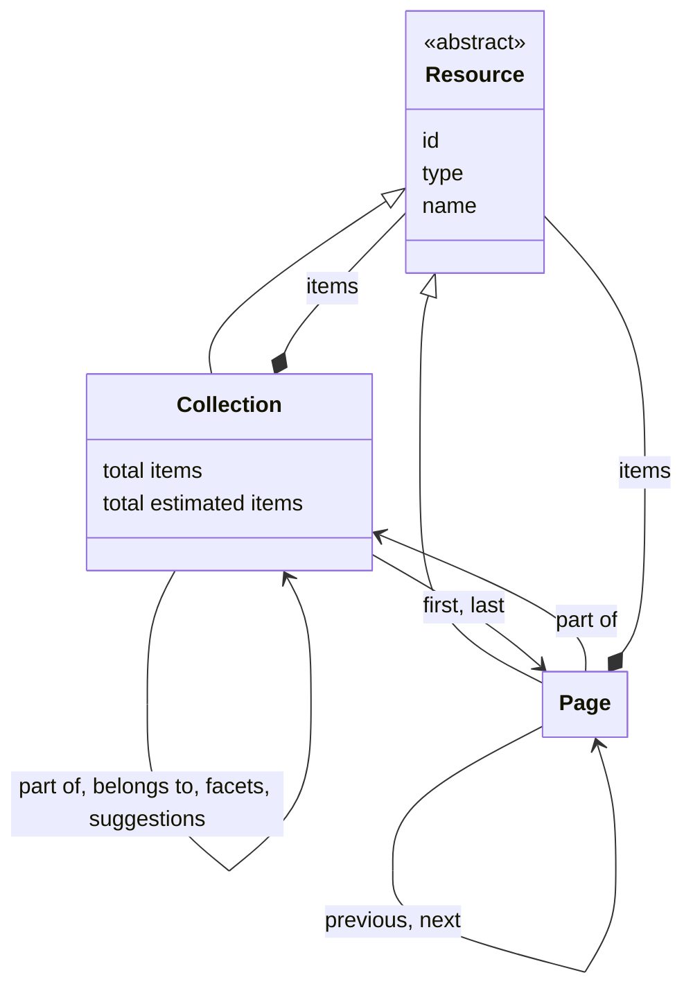
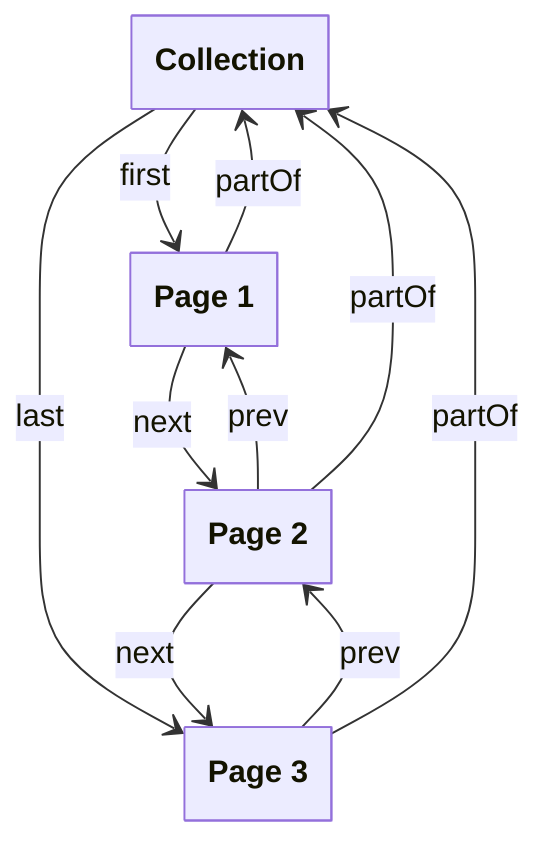

# Resources

## Introduction

The API of an integration layer is centered around resources. A resource represents a 'thing' of a certain type. It can correspond to anything — from a physical object (e.g. a building or a person) to an abstract concept (e.g. a collection or a type of art work).

## Data model

This specification defines resource types on several pages. This page describes the generic types from which all other resource types extend:

| Name       | Description                                                                                                                                                                                                                                                                                                                                                                                                                |
| ---------- | -------------------------------------------------------------------------------------------------------------------------------------------------------------------------------------------------------------------------------------------------------------------------------------------------------------------------------------------------------------------------------------------------------------------------- |
| Resource   | A 'thing' of a certain type. All other resource types extend from it. It is the umbrella term for everything the integration layer publishes and a presentation layer can interact with. A Resource is abstract: there is no resource whose type is `Resource` — it needs a concrete type. This specification defines a number of concrete types. The integration layer may additionally [define its own types](types.md). |
| Collection | An ordered list of resources. A Collection may contain further collections, and may consist of pages, containing sublists of the resources in the collection.                                                                                                                                                                                                                                                              |
| Page       | An ordered sublist of resources within a Collection.                                                                                                                                                                                                                                                                                                                                                                       |

The following class diagram visualises the relationships between the resource types:



The [Collections](collections.md), [Entities](entities.md), [Facets](facets.md) and [Suggestions](suggestions.md) pages define the resource types that specialise them.

## Resource

A Resource, regardless of type, contains at least the following properties:

| Name   | Data type | Cardinality | Description                                                                                                                                                                                                                                           |
| ------ | --------- | ----------- | ----------------------------------------------------------------------------------------------------------------------------------------------------------------------------------------------------------------------------------------------------- |
| `type` | string    | 1           | The type of the resource. This specification defines a number of types. The integration layer may additionally define its own types.                                                                                                                  |
| `id`   | string    | 0 or 1      | The identifier of the resource. It _MUST_ be a dereferenceable [HTTP URI](https://httpwg.org/specs/rfc9110.html#uri.schemes). Optional for volatile, non-persistent resources, such as [Keyword Values](suggestions.md) or [Facet Values](facets.md). |
| `name` | string    | 0 or 1      | The name of the resource, if known.                                                                                                                                                                                                                   |

The integration layer _MUST_ include `type` in the response body of every resource it returns, and `id` and `name` when they are known. The combination of these three properties allow a presentation layer to identify a resource.

### Example

Example of the response body of the integration layer:

```json
{
  "@context": "https://example.org/v1/context.json",
  "id": "https://example.org/v1/entities/1234",
  "type": "HeritageObject",
  "name": "The Night Watch",
  // And then, depending on the resource, other properties, such as:
  "additionalType": [
    {
      "id": "https://example.org/v1/entities/5678",
      "type": "Concept",
      "name": "Painting"
    }
  ],
  "description": "Rembrandt’s largest, most famous canvas was made for the Arquebusiers guild hall..."
}
```

The response indicates that this resource has identifier `https://example.org/v1/entities/1234`, is a `HeritageObject` and has name 'The Night Watch'.

Note the `additionalType` list: every item in this list is also a resource and has the same top-level properties: `id`, `type` and `name`.

## Collection

A Collection contains at least the following properties:

| Name                  | Data type  | Cardinality | Description                                                                                                                                                                                                                                                        |
| --------------------- | ---------- | ----------- | ------------------------------------------------------------------------------------------------------------------------------------------------------------------------------------------------------------------------------------------------------------------ |
| `id`                  | string     | 1           | The identifier of the collection.                                                                                                                                                                                                                                  |
| `type`                | string     | 1           | The type of the collection. It _MUST_ be `Collection` or a specialisation.                                                                                                                                                                                         |
| `name`                | string     | 1           | The name of the collection.                                                                                                                                                                                                                                        |
| `totalItems`          | number     | 0 or 1      | The exact total number of items in the collection, being its further collections, its resources, or both. The property _MAY_ be omitted by the integration layer if the exact total is too costly to calculate. Mutually exclusive with `estimatedTotalItems`.     |
| `estimatedTotalItems` | number     | 0 or 1      | An estimate of the total number of items in the collection. It can be higher or lower than the real total. The property _MAY_ be omitted by the integration layer if it has no estimate. Mutually exclusive with `totalItems`.                                     |
| `items`               | array      | 0 or 1      | A list of the items in the collection. Not set if the Collection is divided into [pages](#page).                                                                                                                                                                   |
| `items[*]`            | Resource   | 1           | A [resource](resources.md#resource). A resource can be of [any type](#data-model), including `Collection` or a specialisation.                                                                                                                                     |
| `pageUriTemplate`     | string     | 0 or 1      | A [URI template](https://www.rfc-editor.org/rfc/rfc6570.html) for the pages of the collection. It contains the `page` variable. Set only if the collection is divided into pages that can be addressed by number. See [Pagination](#pagination).                   |
| `first`               | Page       | 0 or 1      | The first page in the collection. Not set if the collection is empty or if it is not divided into [pages](#page).                                                                                                                                                  |
| `first.id`            | string     | 1           | The identifier of the first page in the collection.                                                                                                                                                                                                                |
| `first.type`          | string     | 1           | The type of the first page in the collection. It _MUST_ be `Page` or a specialisation.                                                                                                                                                                             |
| `last`                | Page       | 0 or 1      | The last page in the collection. Not set if the collection is empty, if the collection is not divided into [pages](#page), or if the last page is unknown (e.g. in case of [cursor navigation](#page-navigation-and-cursor-navigation)).                           |
| `last.id`             | string     | 1           | The identifier of the last page in the collection.                                                                                                                                                                                                                 |
| `last.type`           | string     | 1           | The type of the last page in the collection. It _MUST_ be `Page` or a specialisation.                                                                                                                                                                              |
| `partOf`              | Collection | 0 or 1      | The collection of which this collection is a part. Not set if this collection is the root of a collection tree.                                                                                                                                                    |
| `partOf.id`           | string     | 1           | The identifier of the collection.                                                                                                                                                                                                                                  |
| `partOf.type`         | string     | 1           | The type of the collection. It _MUST_ be `Collection` or a specialisation.                                                                                                                                                                                         |
| `partOf.name`         | string     | 1           | The name of the collection.                                                                                                                                                                                                                                        |
| `belongsTo`           | Collection | 0 or 1      | The collection that the collections in this collection belong to, such as a list of [facet collections](facets.md) that belongs to a curated collection. Not set if this collection does not group collections of another collection.                              |
| `belongsTo.id`        | string     | 1           | The identifier of the collection.                                                                                                                                                                                                                                  |
| `belongsTo.type`      | string     | 1           | The type of the collection. It _MUST_ be `Collection` or a specialisation.                                                                                                                                                                                         |
| `belongsTo.name`      | string     | 1           | The name of the collection.                                                                                                                                                                                                                                        |
| `facets`              | Collection | 0 or 1      | The collection of this collection's facet collections. Not set if the collection does not offer facets, or if the collection is a facet collection: a facet collection _MUST NOT_ offer facets itself. See [Facets](facets.md).                                    |
| `facets.id`           | string     | 1           | The identifier of the collection.                                                                                                                                                                                                                                  |
| `facets.type`         | string     | 1           | The type of the collection. It _MUST_ be `Collection` or a specialisation.                                                                                                                                                                                         |
| `facets.name`         | string     | 1           | The name of the collection.                                                                                                                                                                                                                                        |
| `suggestions`         | Collection | 0 or 1      | The collection of this collection's suggestion collections. Not set if the collection does not offer suggestions, or if the collection is a suggestion collection: a suggestion collection _MUST NOT_ offer suggestions itself. See [Suggestions](suggestions.md). |
| `suggestions.id`      | string     | 1           | The identifier of the collection.                                                                                                                                                                                                                                  |
| `suggestions.type`    | string     | 1           | The type of the collection. It _MUST_ be `Collection` or a specialisation.                                                                                                                                                                                         |
| `suggestions.name`    | string     | 1           | The name of the collection.                                                                                                                                                                                                                                        |
| `queryables`          | Queryables | 0 or 1      | The Queryables resource of this collection. It lists the properties that can be used in a filter. A collection that advertises the `advanced-search` capability _MUST_ set it. See [Queryables](search.md#queryables).                                             |
| `queryables.id`       | string     | 1           | The identifier of the Queryables resource.                                                                                                                                                                                                                         |
| `queryables.type`     | string     | 1           | The type of the resource. It _MUST_ be `Queryables`.                                                                                                                                                                                                               |
| `capabilities`        | array      | 0 or 1      | The URIs of the capabilities the integration layer implements for this collection. It _MUST_ be omitted if the collection supports no capabilities. See [Capability discovery](#capability-discovery).                                                             |

### Collection tree

Collections form a tree: the `items` of a collection can contain further collections. There is no separate type for a 'collection of collections': a collection that groups other collections is a collection like any other. This keeps the structure a presentation layer has to learn down to one collection type.

Every collection tree has one root: the collection that has no `partOf`. Every other collection in that tree _MUST_ have a `partOf`. This makes the tree connected and every collection in it reachable from its root. A collection _MUST NOT_ be part of itself, directly or indirectly: the tree _MUST_ be acyclic, so that a presentation layer can traverse it without looping.

An integration layer _MAY_ offer more than one collection tree. The [facet collections](facets.md#endpoint-retrieve-the-facet-collections-of-a-collection) and [suggestion collections](suggestions.md#endpoint-retrieve-the-suggestion-collections-of-a-collection) of a collection, for example, form trees of their own. Their root is not part of the collection tree of that collection — it has no `partOf` and uses `belongsTo` instead.

A presentation layer walks a tree from its root. It requests the root, and for every item in a collection it recurses if the item's `type` is `Collection` or a specialisation of it, and renders the item as a resource otherwise. It does not need to know in advance whether a collection holds further collections or resources, or whether the collections it encounters are divided into pages. Every collection, including one that groups other collections, can be divided into pages, so a tree with many branches can be traversed a page at a time.

### Paths

Every collection has a path: the URI a presentation layer uses to request it.

This specification defines the paths of some collections and the endpoints that belong to them:

| Path                                                   | Resource                                      |
| ------------------------------------------------------ | --------------------------------------------- |
| `/{version}/collections`                               | The root of the curated collection tree.      |
| `/{version}/collections/{...collections}/{collection}` | A curated collection.                         |
| `/{version}/{...collections}/search`                   | The advanced search endpoint of a collection. |
| `/{version}/{...collections}/queryables`               | The Queryables resource of a collection.      |
| `/{version}/{...collections}/facets`                   | The facet collections of a collection.        |
| `/{version}/{...collections}/facets/{facet}`           | One facet collection.                         |
| `/{version}/{...collections}/suggestions`              | The suggestion collections of a collection.   |
| `/{version}/{...collections}/suggestions/{suggestion}` | One suggestion collection.                    |

The words `collections`, `facets`, `queryables`, `suggestions` and `search` are reserved: a path identifier _MUST NOT_ be one of them. A path like `/{version}/collections/facets/facets` would otherwise match two of the paths above at once: a curated collection 'facets' inside a curated collection 'facets', and the facet collections of a curated collection 'facets'. Neither the integration layer nor a presentation layer can then say which one a URI means. A collection named `search` would in the same way be indistinguishable from the advanced search endpoint of the collection it is a part of.

A presentation layer does not have to build these paths. It finds the facet collections, the suggestion collections and the Queryables resource of a collection in the `facets`, `suggestions` and `queryables` properties, which hold the full URI of each resource. The fixed paths tell an integration layer where to put them, and give a presentation layer a URI it can link to.

The path identifiers themselves are a choice of the integration layer: it names each of its collections, facet collections and suggestion collections itself. See [resource identifiers](#resource-identifiers). An integration layer _MAY_ expose the same collection at more than one path.

### Example

Example of the response body of the integration layer's root collection:

```json
{
  "@context": "https://example.org/v1/context.json",
  "id": "https://example.org/v1/collections",
  "type": "Collection",
  "name": "Collections",
  "totalItems": 2,
  "items": [
    {
      "id": "https://example.org/v1/collections/objects",
      "type": "Collection",
      "name": "Heritage objects"
    },
    {
      "id": "https://example.org/v1/collections/persons",
      "type": "Collection",
      "name": "Persons"
    }
  ]
}
```

The response indicates that the root groups two further collections, 'Heritage objects' and 'Persons'.

Example of the response body when the collection is divided into pages:

```json
{
  "@context": "https://example.org/v1/context.json",
  "id": "https://example.org/v1/collections/objects",
  "type": "Collection",
  "name": "Heritage objects",
  "totalItems": 195,
  "first": {
    "id": "https://example.org/v1/collections/objects?page=1",
    "type": "Page"
  },
  "partOf": {
    "id": "https://example.org/v1/collections",
    "type": "Collection",
    "name": "Collections"
  },
  "pageUriTemplate": "https://example.org/v1/collections/objects{?page}"
}
```

The response indicates that this collection consists of 195 items, accessible via the `first` page.

## Page

A Page contains at least the following properties:

| Name                         | Data type  | Cardinality | Description                                                                                                                                                                                                                                                           |
| ---------------------------- | ---------- | ----------- | --------------------------------------------------------------------------------------------------------------------------------------------------------------------------------------------------------------------------------------------------------------------- |
| `id`                         | string     | 1           | The identifier of the page.                                                                                                                                                                                                                                           |
| `type`                       | string     | 1           | The type of the page. It _MUST_ be `Page` or a specialisation.                                                                                                                                                                                                        |
| `name`                       | string     | 1           | The name of the page.                                                                                                                                                                                                                                                 |
| `items`                      | array      | 1           | A list of resources in the page. Empty if there are no resources.                                                                                                                                                                                                     |
| `items[*]`                   | Resource   | 1           | A [resource](resources.md#resource). A resource can be of [any type](#data-model).                                                                                                                                                                                    |
| `prev`                       | Page       | 0 or 1      | The previous page in the collection. Not set if there is no previous page.                                                                                                                                                                                            |
| `prev.id`                    | string     | 1           | The identifier of the previous page in the collection.                                                                                                                                                                                                                |
| `prev.type`                  | string     | 1           | The type of the previous page in the collection. It _MUST_ be `Page` or a specialisation.                                                                                                                                                                             |
| `next`                       | Page       | 0 or 1      | The next page in the collection. Not set if there is no next page.                                                                                                                                                                                                    |
| `next.id`                    | string     | 1           | The identifier of the next page in the collection.                                                                                                                                                                                                                    |
| `next.type`                  | string     | 1           | The type of the next page in the collection. It _MUST_ be `Page` or a specialisation.                                                                                                                                                                                 |
| `partOf`                     | Collection | 1           | The collection to which the items contained by the page belong.                                                                                                                                                                                                       |
| `partOf.id`                  | string     | 1           | The identifier of the collection.                                                                                                                                                                                                                                     |
| `partOf.type`                | string     | 1           | The type of the collection. It _MUST_ be `Collection` or a specialisation.                                                                                                                                                                                            |
| `partOf.name`                | string     | 1           | The name of the collection.                                                                                                                                                                                                                                           |
| `partOf.totalItems`          | number     | 0 or 1      | The exact total number of items in the collection, being its further collections, its resources, or both. The property _MAY_ be omitted by the integration layer if the exact total is too costly to calculate. Mutually exclusive with `partOf.estimatedTotalItems`. |
| `partOf.estimatedTotalItems` | number     | 0 or 1      | An estimate of the total number of items in the collection. It can be higher or lower than the real total. The property _MAY_ be omitted by the integration layer if it has no estimate. Mutually exclusive with `partOf.totalItems`.                                 |
| `partOf.pageUriTemplate`     | string     | 0 or 1      | A [URI template](https://www.rfc-editor.org/rfc/rfc6570.html) for the pages of the collection. It contains the `page` variable. Set only if the pages can be addressed by number. See [Pagination](#pagination).                                                      |
| `partOf.first`               | Page       | 1           | The first page in the collection.                                                                                                                                                                                                                                     |
| `partOf.first.id`            | string     | 1           | The identifier of the first page in the collection.                                                                                                                                                                                                                   |
| `partOf.first.type`          | string     | 1           | The type of the first page in the collection. It _MUST_ be `Page` or a specialisation.                                                                                                                                                                                |
| `partOf.last`                | Page       | 0 or 1      | The last page in the collection. Not set if the last page is unknown (e.g. in case of [cursor navigation](#page-navigation-and-cursor-navigation)).                                                                                                                   |
| `partOf.last.id`             | string     | 1           | The identifier of the last page in the collection.                                                                                                                                                                                                                    |
| `partOf.last.type`           | string     | 1           | The type of the last page in the collection. It _MUST_ be `Page` or a specialisation.                                                                                                                                                                                 |

### Pagination

Pagination means splitting the items of a collection into smaller lists. Each smaller list is a Page. A Page is a resource of its own: it has its own identifier, and a presentation layer requests it like any other resource.

An integration layer needs pagination when its collections are large. A single collection may contain hundreds of thousands of items. It is impractical to return all of them in one response: the response takes long to build and long to download, and a presentation layer usually shows only a few items at a time. With pagination, the integration layer returns a small number of items per response, and the presentation layer asks for more only when it needs more.

An integration layer _MAY_ divide any collection into pages. It does not have to. A collection _MAY_ return all of its items at once, in its `items` property.

#### Pages and collections

A collection that is divided into pages has two properties that point to its pages:

- `first`: the first page of the collection.
- `last`: the last page of the collection, if the integration layer knows it.

A page has three properties that point to its place in the collection:

- `prev`: the page before it, if there is one.
- `next`: the page after it, if there is one.
- `partOf`: the collection that the page belongs to.

With these properties, a presentation layer walks through a collection. It requests the collection and follows `first`. It then follows `next` until there is no `next` left, which means it has reached the end. It goes back with `prev`, or it jumps to the end with the collection's `last`.

The `prev` and the `next` of a page _MUST_ be pages of the same collection. They _MUST_ also point back at each other: if the `next` of one page is another page, the `prev` of that other page _MUST_ be the first one. The pages of a collection _MUST_ form one sequence without loops, so that a presentation layer can walk through them without getting stuck. The `first` of a collection _MUST_ be the page that has no `prev`. Its `last`, if it is set, _MUST_ be the page that has no `next`.

The following diagram visualises the relationships:



#### Page navigation and cursor navigation

Pagination means that a collection is split into pages. Navigation is how a presentation layer moves through those pages. An integration layer uses one of two pagination strategies: page navigation and cursor navigation.

A presentation layer asks for a page with the `page` query parameter. The value of `page` is either a number or a cursor:

- **Page navigation**: the value is a number that says which page the presentation layer wants, such as `?page=3`.
- **Cursor navigation**: the value is a token that the integration layer has given itself, such as `?page=eyJpZCI6MTIzfQ`. The token points to a place in the collection.

Both are allowed. An integration layer _MAY_ use page navigation, _MAY_ use cursor navigation, and _MAY_ use both across its collections. For predictable navigation, it is _RECOMMENDED_ that an integration layer uses the same strategy for all of its collections, so that a presentation layer can handle every collection in one way.

With page navigation, a presentation layer can build the URI of any page itself. The collection tells it how with its [`pageUriTemplate`](#collection) property. The property is a [URI template](https://www.rfc-editor.org/rfc/rfc6570.html), an IETF standard for describing URIs with variables. The template contains the `page` variable. A presentation layer can replace it with a number. For example:

```
https://example.org/v1/collections/objects{?page}
```

Expanding the template with `3` gives `https://example.org/v1/collections/objects?page=3`. If the collection has a query, the template contains that query too and appends the page with `{&page}`:

```
https://example.org/v1/collections/objects?q=rembrandt{&page}
```

Expanding this template with `3` gives `https://example.org/v1/collections/objects?q=rembrandt&page=3`. Because the integration layer builds the template, it contains every parameter that selects the result set, such as `q`, `orderBy`, `size`, `search` and `context`. A presentation layer _MUST NOT_ add or change any other parameter: it only fills in the page number. That way it cannot lose a filter or a sort order while navigating.

The value of the `page` variable is the number of the page, starting at `1`. A presentation layer expands the template when it wants a specific page whose number it already knows, such as the page that a user selected or the page it calculated from an item offset. Only when it starts from a page URI that it did not build itself, such as a bookmark or an external link, does it read the `page` query parameter of that URI to learn the number.

A collection that is divided into pages and uses page navigation _MUST_ set `pageUriTemplate`. The template _MUST_ be a valid URI template and _MUST_ contain the `page` variable. Expanding it with a number _MUST_ return that page of the same collection and the same result set. The first page _MUST_ be page `1`.

A collection that uses cursor navigation _MUST NOT_ set `pageUriTemplate`. A cursor is a token that only the integration layer can make, so a presentation layer cannot construct one; it can only follow the page URIs that the integration layer returns. A collection that is not divided into pages _MUST NOT_ set the property either. A presentation layer therefore knows that a collection which is divided into pages but has no `pageUriTemplate` uses cursor navigation.

Counting all items of a collection costs time. Page navigation usually needs that number to know which page comes last, and cursor navigation usually does not. An integration layer that uses page navigation _MAY_ return an exact `totalItems`, and an integration layer that uses cursor navigation _MAY_ return an `estimatedTotalItems`. An integration layer _MAY_ return either property with either strategy.

Page navigation is easy to use. A presentation layer can send a user straight to page 7, and the user sees 'page 7 of 20'. The cost is that the integration layer has to count or skip over items, which becomes slow on a large collection. It also becomes less reliable over time: if items are added or removed while a user is browsing, the numbers move, and the user can see an item twice or miss it.

With cursor navigation, the integration layer does not have to count. It remembers where the previous response ended and continues from there. This is fast on a large collection, and it does not shift when items are added or removed. The cost is that a presentation layer cannot jump to an arbitrary page, because it has no number to jump to. For that reason a collection that uses cursor navigation usually has no `last` page: the integration layer does not know which page is last. An integration layer that does know _MAY_ set `last`. A presentation layer can then follow `last` and walk back through the collection with `prev`.

A cursor is a token that only the integration layer understands. A presentation layer _MUST_ pass a cursor back unchanged, and _MUST NOT_ try to read it or build one. A cursor _MUST_ only be used with the collection and the query it came from. A presentation layer _MUST NOT_ reuse a cursor for another collection or another query.

An integration layer _MUST_ respond with a `400` status code if `page` has a value of the wrong kind for the strategy that the collection uses: a number where the collection expects a cursor, or a cursor where it expects a number. It _MUST NOT_ treat a `page` value it does not understand as page 1, because a presentation layer would then be shown the wrong page without knowing it.

### Example

The examples below show the two ways in which a presentation layer can navigate through a collection.

Example of the response body with page navigation:

```json
{
  "@context": "https://example.org/v1/context.json",
  "id": "https://example.org/v1/collections/objects?page=3",
  "type": "Page",
  "name": "Heritage objects: page 3",
  "items": [
    {
      "id": "https://example.org/v1/entities/1234",
      "type": "HeritageObject",
      "name": "The Night Watch"
      // Other properties...
    }
    // Other items...
  ],
  "prev": {
    "id": "https://example.org/v1/collections/objects?page=2",
    "type": "Page"
  },
  "next": {
    "id": "https://example.org/v1/collections/objects?page=4",
    "type": "Page"
  },
  "partOf": {
    "id": "https://example.org/v1/collections/objects",
    "type": "Collection",
    "name": "Heritage objects",
    "totalItems": 195,
    "pageUriTemplate": "https://example.org/v1/collections/objects{?page}",
    "first": {
      "id": "https://example.org/v1/collections/objects?page=1",
      "type": "Page"
    },
    "last": {
      "id": "https://example.org/v1/collections/objects?page=20",
      "type": "Page"
    }
  }
}
```

The response indicates that this page contains items (`items`), is related to a previous page (`prev`) and a next page (`next`) and its items are part of a collection (`partOf`). Because the integration layer knows which page is last, `partOf` points to it.

Example of the response body with cursor navigation:

```json
{
  "@context": "https://example.org/v1/context.json",
  "id": "https://example.org/v1/collections/objects?page=eyJpZCI6MTIzfQ",
  "type": "Page",
  "name": "Heritage objects",
  "items": [
    {
      "id": "https://example.org/v1/entities/1234",
      "type": "HeritageObject",
      "name": "The Night Watch"
      // Other properties...
    }
    // Other items...
  ],
  "prev": {
    "id": "https://example.org/v1/collections/objects?page=eyJpZCI6MTAwfQ",
    "type": "Page"
  },
  "next": {
    "id": "https://example.org/v1/collections/objects?page=eyJpZCI6MTQ1fQ",
    "type": "Page"
  },
  "partOf": {
    "id": "https://example.org/v1/collections/objects",
    "type": "Collection",
    "name": "Heritage objects",
    "totalItems": 195,
    "first": {
      "id": "https://example.org/v1/collections/objects?page=eyJpZCI6MX0",
      "type": "Page"
    }
  }
}
```

This response has the same properties as the previous one, with three differences. The page is identified by a cursor instead of a number. The `partOf` property has no `pageUriTemplate`, because a presentation layer cannot build a cursor itself. It also has no `last`, because the integration layer does not know which page is last. A presentation layer can walk through the collection with `next`, but it cannot jump to the end.

## Capability discovery

A collection can do more than return a list of items. It can support a simple search, an advanced search, facets or suggestions. Each of these is a **capability**: a feature that a collection supports. Every collection advertises its own capabilities, so that a presentation layer can discover which features a collection offers.

This specification defines the following capabilities:

| Capability URI                                 | Description                                                                       |
| ---------------------------------------------- | --------------------------------------------------------------------------------- |
| `https://specs.nde.nl/rest/v1/simple-search`   | The collection supports a [simple search](search.md#endpoint-simple-search).      |
| `https://specs.nde.nl/rest/v1/advanced-search` | The collection supports an [advanced search](search.md#endpoint-advanced-search). |
| `https://specs.nde.nl/rest/v1/facets`          | The collection supports [facets](facets.md).                                      |
| `https://specs.nde.nl/rest/v1/suggestions`     | The collection supports [suggestions](suggestions.md).                            |

Capabilities are a property of a single collection. A presentation layer _MUST NOT_ infer the capabilities of a collection from the capabilities of its ancestors in the collection tree.

The `capabilities` property tells a presentation layer that a collection supports a feature. It does not tell it how to use that feature; the endpoints and query parameters of the collection do.

Some capabilities come with a property that points to another resource. The `facets` property of a collection points to its list of facet collections; see [Facets](facets.md). The `suggestions` property points to its list of suggestion collections; see [Suggestions](suggestions.md). The `queryables` property points to its Queryables resource; see [Queryables](search.md#queryables).

## Resource identifiers

A resource is identified by a URI. The requirements below apply to those URIs. They follow the [REST API Design Rules](https://logius-standaarden.github.io/API-Design-Rules/#resources), which are the source and give the wider context.

1. A resource _MUST_ be named with a noun, not a verb: a resource is a thing, not an action. For example: `https://example.org/v1/collections/works-of-art`, not `https://example.org/v1/collections/search-works-of-art`.
1. A collection resource _MUST_ be named with a plural noun. For example: `https://example.org/v1/collections/works-of-art`, not `https://example.org/v1/collections/work-of-art`.
1. A URI _MUST NOT_ end with a trailing slash. For example: `https://example.org/v1/collections/works-of-art`, not `https://example.org/v1/collections/works-of-art/`.
1. A path segment _MUST_ contain only lowercase letters, digits and hyphens. For example: `https://example.org/v1/collections/works-of-art`, not `https://example.org/v1/collections/Works-of-Art` or `https://example.org/v1/collections/works_of_art`.
1. A query key _MUST_ use camel case. For example: `https://example.org/v1/collections/works-of-art?orderBy=dateCreated`, not `https://example.org/v1/collections/works-of-art?order-by=date-created`.

Regardless of these requirements, a URI _MUST_ still be treated as an opaque string by a presentation layer. A presentation layer _MUST NOT_ rely on the pattern of a URI. The patterns help developers understand the API, not software to interact with it.
