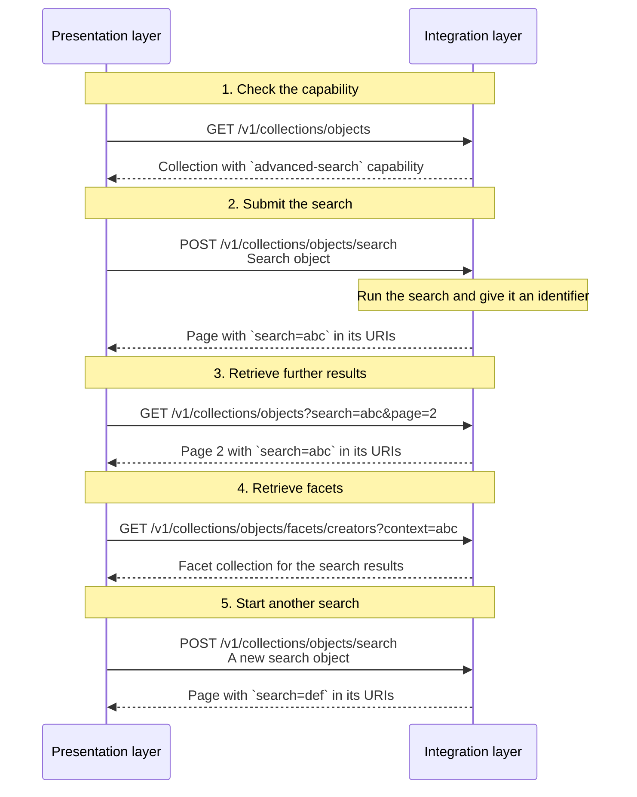

# Search

## Introduction

Search is crucial to help the users of presentation layers find information. A search is tied to a particular collection — the context collection — ensuring that results remain within the context of that collection. A presentation layer can search the items of that collection in two ways: with a **simple search** or with an **advanced search**.

Both forms of search are optional. An integration layer _MAY_ implement simple search, advanced search, or both, depending on its requirements.

## Endpoint: Simple search

A simple search lets a user find items in a collection with a keyword query and a sort order. It is meant for quick, straightforward filtering.

A collection that supports a simple search advertises the `https://specs.nde.nl/rest/v1/simple-search` capability.

A simple search is not a separate endpoint. This section shows how the search parameters are used on the endpoint that retrieves a collection or a page. The example below uses a [curated collection](collections.md); the same parameters apply to the endpoints of other collection types.

### HTTP request

`GET /{version}/{...collections}?q={q}&orderBy={orderBy}&size={size}&page={page}`

### Path parameters

| Name             | Data type | Cardinality | Description                                                                       |
| ---------------- | --------- | ----------- | --------------------------------------------------------------------------------- |
| `version`        | string    | 1           | The version of the API. Example: `v1`.                                            |
| `...collections` | string    | 1 or more   | The path identifier(s) of the context collection. Example: `collections/objects`. |

### Query parameters

| Name      | Data type | Cardinality | Description                                                                                                                                                                                                                                                                                                                                                                                                                                                                                                                                            |
| --------- | --------- | ----------- | ------------------------------------------------------------------------------------------------------------------------------------------------------------------------------------------------------------------------------------------------------------------------------------------------------------------------------------------------------------------------------------------------------------------------------------------------------------------------------------------------------------------------------------------------------ |
| `q`       | string    | 0 or 1      | A keyword query for filtering the items. The integration layer defines the minimum and maximum length and how the query is matched.                                                                                                                                                                                                                                                                                                                                                                                                                    |
| `orderBy` | string    | 0 or 1      | The sorting order of the items: a comma-separated list of sort criteria, in priority order. Each criterion is `property` or `property:order`, where `property` is `relevance` or `value` and `order` is `asc` or `desc`. Example: `relevance:desc,value:asc`. The integration layer defines the default order and which property `value` sorts on (e.g. the `name` of an entity). `relevance` typically expresses how well an item matches the keyword query (`q`). An integration layer _MAY_ also apply its own relevance rules when `q` is missing. |
| `size`    | number    | 0 or 1      | The maximum number of items to retrieve. The minimum is 1. The integration layer defines the maximum.                                                                                                                                                                                                                                                                                                                                                                                                                                                  |
| `page`    | string    | 0 or 1      | The page to retrieve: a page number or a cursor, depending on the [pagination strategy](resources.md#page-navigation-and-cursor-navigation). Required when retrieving a page.                                                                                                                                                                                                                                                                                                                                                                          |

### Request body

None.

### Response body

The response is a `Page` if the collection is divided into pages; otherwise it is a `Collection` with its items inline.

### Example

An example request from a presentation layer:

```http
GET /v1/collections/masterpieces?q=rembrandt&orderBy=relevance:desc,value:asc
Host: example.org
```

This tells the integration layer that the presentation layer is searching for resources in the 'Masterpieces' collection that match the keyword 'rembrandt' and that matching resources must be ordered by relevance, descending, and then by value, ascending.

An example of the response of the integration layer:

```json
{
  "@context": "https://example.org/v1/context.json",
  "id": "https://example.org/v1/collections/masterpieces?q=rembrandt&orderBy=relevance:desc,value:asc&page=1",
  "type": "Page",
  "name": "Masterpieces: page 1",
  "items": [
    {
      "id": "https://example.org/v1/entities/1234",
      "type": "HeritageObject",
      "name": "The Night Watch"
    }
    // Other items...
  ],
  "next": {
    "id": "https://example.org/v1/collections/masterpieces?q=rembrandt&orderBy=relevance:desc,value:asc&page=2",
    "type": "Page"
  },
  "partOf": {
    "id": "https://example.org/v1/collections/masterpieces?q=rembrandt&orderBy=relevance:desc,value:asc",
    "type": "CuratedCollection",
    "name": "Masterpieces",
    "totalItems": 42,
    "first": {
      "id": "https://example.org/v1/collections/masterpieces?q=rembrandt&orderBy=relevance:desc,value:asc&page=1",
      "type": "Page"
    },
    "last": {
      "id": "https://example.org/v1/collections/masterpieces?q=rembrandt&orderBy=relevance:desc,value:asc&page=3",
      "type": "Page"
    }
  }
}
```

The response indicates that the simple search has 42 results, that this is the first page, and that the next page is page 2.

## Endpoint: Advanced search

An advanced search lets a user narrow down the items of a collection with complex conditions, such as filters with 'and' and 'or', date ranges, geolocation and facet values. It can combine these conditions with a keyword query, a sort order and a page size.

A collection that supports an advanced search advertises the `https://specs.nde.nl/rest/v1/advanced-search` capability.

### HTTP request

`POST /{version}/{...collections}/search`

An advanced search uses the `POST` method because the `GET` method with a query string is not a good fit for complex filter conditions: it has a limited length, and conditions with 'and' and 'or' are hard to read and to parse.

### Path parameters

| Name             | Data type | Cardinality | Description                                                                       |
| ---------------- | --------- | ----------- | --------------------------------------------------------------------------------- |
| `version`        | string    | 1           | The version of the API. Example: `v1`.                                            |
| `...collections` | string    | 1 or more   | The path identifier(s) of the context collection. Example: `collections/objects`. |

### Query parameters

None.

### Request body

The request body _MUST_ contain a JSON-formatted [search object](#search-object).

### Response body

The response is a `Page` if the collection is divided into pages; otherwise it is a `Collection` with its items inline. The response URIs contain the [search identifier](#search-identifier).

### Search object

A search object is a JSON object. It contains the conditions of an advanced search:

| Name                  | Data type | Cardinality | Description                                                                                                                                                                                                                                                                                                                                                                                                                                                                        |
| --------------------- | --------- | ----------- | ---------------------------------------------------------------------------------------------------------------------------------------------------------------------------------------------------------------------------------------------------------------------------------------------------------------------------------------------------------------------------------------------------------------------------------------------------------------------------------- |
| `q`                   | string    | 0 or 1      | A keyword query. It has the same meaning as the `q` query parameter of a [simple search](#endpoint-simple-search).                                                                                                                                                                                                                                                                                                                                                                 |
| `orderBy`             | array     | 0 or 1      | An ordered list of sort criteria. The criteria apply in array order. If absent, the integration layer defines the order. It has the same meaning as the `orderBy` query parameter of a [simple search](#endpoint-simple-search).                                                                                                                                                                                                                                                   |
| `orderBy[*]`          | object    | 1           | A sort criterion.                                                                                                                                                                                                                                                                                                                                                                                                                                                                  |
| `orderBy[*].property` | string    | 1           | The property to sort on. It _MUST_ be `relevance` or `value`. The integration layer defines which property `value` sorts on. `relevance` typically expresses how well an item matches the keyword query (`q`). An integration layer _MAY_ also apply its own relevance rules when `q` is missing.                                                                                                                                                                                  |
| `orderBy[*].order`    | string    | 1           | The direction of the sort. It _MUST_ be `asc` or `desc`.                                                                                                                                                                                                                                                                                                                                                                                                                           |
| `size`                | number    | 0 or 1      | The maximum number of items to retrieve. It has the same meaning as the `size` query parameter of a [simple search](#endpoint-simple-search).                                                                                                                                                                                                                                                                                                                                      |
| `filter`              | object    | 0 or 1      | The filter conditions. See [Filters](#filters).                                                                                                                                                                                                                                                                                                                                                                                                                                    |
| `facets`              | array     | 0 or 1      | The facet collections whose results the integration layer must return. See [Facets](facets.md).                                                                                                                                                                                                                                                                                                                                                                                    |
| `context`             | string    | 0 or 1      | An identifier for an [advanced search](#endpoint-advanced-search) of the context collection. It selects the items on which the items of a [facet collection](facets.md) are based. See [Search context](facets.md#search-context). Only used when the collection that is searched is a facet collection. The identifier _MUST_ identify an advanced search of that facet collection's context collection; otherwise the integration layer _MUST_ respond with a `400` status code. |

All properties are optional. An empty object returns the items of the collection in their default order.

An example of a search object:

```json
{
  "q": "rembrandt",
  "orderBy": [
    {
      "property": "relevance",
      "order": "desc"
    },
    {
      "property": "value",
      "order": "asc"
    }
  ],
  "size": 20,
  "filter": {
    "and": [
      {
        "property": "dateCreated",
        "operator": "between",
        "value": ["1900", "1950"]
      },
      {
        "property": "creator",
        "operator": "in",
        "value": [
          "https://example.org/v1/entities/7890",
          "https://example.org/v1/entities/9012"
        ]
      }
    ]
  }
}
```

The example searches the collection for items that match the keyword query `rembrandt`, were created between 1900 and 1950, and have one of two creators. It returns 20 items per page, sorted by relevance, descending, and then by value, ascending.

Another example:

```json
{
  "filter": {
    "or": [
      {
        "and": [
          {
            "property": "dateCreated",
            "operator": "between",
            "value": ["1900", "1950"]
          },
          {
            "property": "creator",
            "operator": "in",
            "value": [
              "https://example.org/v1/entities/7890",
              "https://example.org/v1/entities/9012"
            ]
          }
        ]
      },
      {
        "property": "locationCreated",
        "operator": "eq",
        "value": "https://example.org/v1/entities/3456"
      }
    ]
  }
}
```

The example searches the collection for items that were created between 1900 and 1950 and have one of two creators, or searches the collection for items that were created in a certain location.

If the search object is invalid, or contains a filter that the collection does not support, the integration layer _MUST_ respond with a `400` status code.

:::note To do

Define the exact structure of the `filter` object. It must be able to express all sorts of filter types, including (nested) `and` and `or` conditions and exclusions (`not`). The examples are a starting point.

:::

:::note To do

Think of a way to express the ID of a `facet` in a search object. A facet ID like `creators` is a shorthand for its full URI but currently does not have a designated property in a [facet collection](facets.md#endpoint-retrieve-a-facet-collection). Full URIs — such as `https://example.org/v1/collections/masterpieces/facets/creators` — are rather verbose.

:::

### Filters

A presentation layer can narrow down the items of a collection with filters. Filters are part of a [search object](#search-object). A presentation layer sends filters in the `filter` property of a search object to the advanced search endpoint.

The filters a collection supports depend on the resources it holds. A [curated collection](collections.md) of entities with geographical data may support a geolocation filter. A [facet collection](facets.md) does not, because its items are facet items rather than entities with a location.

This specification describes the following filter types:

1. **Keyword filter**: filtering on text, with wildcards and phrases (e.g. `Rem`, `Rem*`, `'Rembrandt van Rijn'`).
1. **Date filter**: filtering by comparing dates (e.g. 'Date of creation is between 1900 and 1950').
1. **Numeric filter**: filtering by comparing numbers (e.g. 'Number of pages is at least 300').
1. **Geolocation filter**: filtering on coordinates and a radius (e.g. 'Location of creation is within 25 km of a geopoint').
1. **Facet filter**: filtering by the values of one of the collection's facets (e.g. 'Creator is "Rembrandt" or "Vincent van Gogh" and Type is "Painting"').

A presentation layer _MUST_ only send filters that the collection supports. If it sends another filter, the integration layer _MUST_ respond with a `400` status code. Ignoring an unsupported filter would silently give the presentation layer more items than it asked for.

### Search identifier

An advanced search needs an identifier, because a presentation layer cannot repeat the search conditions in later requests. It sends the conditions in the body of the `POST` request that starts the search, but it retrieves pages and facets with `GET` requests, which have no request body. The identifier lets the presentation layer refer to the same search in those requests.

The integration layer returns the identifier in the response URIs of the advanced search. In those URIs, it appears as the `search` query string parameter: that parameter is the protocol implementation of the identifier.

An identifier is opaque. A presentation layer _MUST NOT_ try to interpret it, build it or change it. It _MUST_ pass the value back unchanged in every subsequent request.

The integration layer connects the identifier to the search object. It can do that in two ways:

- **Stateless**: the integration layer encodes the search object in the identifier itself. It _MAY_ compress, sign or encrypt the value. It _MAY_ also use a plain encoding, such as Base64URL, as long as it validates the decoded search object before using it. For example, the identifier may be the JSON search object compressed and then encoded with Base64URL.
- **Stateful**: the integration layer stores the search object on its server and gives the identifier a value that refers to it. It manages the lifecycle of the stored object itself, such as its expiry date. For example, the identifier may be a random UUID that the integration layer uses as the key of the stored search object in a database.

Both implementations look the same to a presentation layer. The specification does not prescribe which one an integration layer uses.

An identifier is bound to the collection and to the search object. A presentation layer _MUST NOT_ use it with another collection or with another advanced search. If it does, the integration layer _MUST_ respond with a `400` status code.

The identifier _MUST_ appear in every URI that navigates the search results: the `id` of the page, `prev.id`, `next.id`, `partOf.id`, `partOf.first.id` and `partOf.last.id`. It _MUST_ also appear in the `first.id` and `last.id` of the filtered collection.

The `search` parameter and the simple search parameters (`q`, `orderBy`, `size`) are mutually exclusive. A presentation layer _MUST NOT_ combine them in one request. If it does, the integration layer _MUST_ respond with a `400` status code.

On a [facet collection](facets.md), the `context` parameter holds the identifier of an advanced search of the facet collection's context collection. It is independent of the `search` parameter: `search` refers to an advanced search of the facet collection itself, while `context` refers to an advanced search of the context collection. See [Search context](facets.md#search-context).

:::note To be discussed

A filtered collection is a view with its own `id`, `totalItems` and pages. Is it part of the collection tree, or a separate, temporary resource? And how long must the identifier remain valid? A URI that contains an identifier is only dereferenceable while the integration layer knows the search object. Should the specification define a minimum lifetime, and what should the integration layer return after that (e.g. `410 Gone`)?

:::

### Example

An example request from a presentation layer:

```http
POST /v1/collections/masterpieces/search
Host: example.org
Content-Type: application/json

{
  "q": "rembrandt",
  "orderBy": [
    {
      "property": "relevance",
      "order": "asc"
    }
  ]
}
```

This tells the integration layer that the presentation layer is searching for resources in the 'Masterpieces' collection that match the keyword 'rembrandt' and that matching resources must be ordered by relevance, ascending.

An example of the response of the integration layer:

```json
{
  "@context": "https://example.org/v1/context.json",
  "id": "https://example.org/v1/collections/masterpieces?search=abc&page=1",
  "type": "Page",
  "name": "Masterpieces: page 1",
  "items": [
    {
      "id": "https://example.org/v1/entities/1234",
      "type": "HeritageObject",
      "name": "The Night Watch"
    }
    // Other items...
  ],
  "next": {
    "id": "https://example.org/v1/collections/masterpieces?search=abc&page=2",
    "type": "Page"
  },
  "partOf": {
    "id": "https://example.org/v1/collections/masterpieces?search=abc",
    "type": "CuratedCollection",
    "name": "Masterpieces",
    "totalItems": 42,
    "first": {
      "id": "https://example.org/v1/collections/masterpieces?search=abc&page=1",
      "type": "Page"
    },
    "last": {
      "id": "https://example.org/v1/collections/masterpieces?search=abc&page=3",
      "type": "Page"
    }
  }
}
```

The response indicates that the advanced search has 42 results, that this is the first page, and that the next page is page 2. The `search` parameter in the URIs of properties `id`, `next.id`, `partOf.id`, `partOf.first.id` and `partOf.last.id` is an identifier for a search object.

### Anatomy of an advanced search

An advanced search takes several requests. A presentation layer starts the search with one request and then uses the search identifier that the response contains to retrieve further results.

The steps below use a collection that is divided into pages as an example. If the integration layer returns the full collection instead, some steps differ: there are no page URIs to follow, but the identifier still appears in the URIs of the collection.

1. **Check that the collection supports an advanced search.** The collection advertises the `https://specs.nde.nl/rest/v1/advanced-search` capability.
2. **Submit the search.** A presentation layer sends a `POST` request with a [search object](#search-object) to the search endpoint of the collection. The integration layer runs the search and returns the first results as a `Page`, or as a `Collection` if it does not divide the collection into pages. It gives the search an identifier and includes it as the `search` parameter in every URI that refers to the search.
3. **Retrieve further results.** If the collection is divided into pages, a presentation layer follows a page URI from the response, such as `next.id`, or adds the `page` query parameter to the `partOf.id` URI. It passes the `search` parameter unchanged. It does not send the search object again: the identifier already refers to it.
4. **Retrieve facets (optional).** A presentation layer requests a [facet collection](facets.md) with the `context` parameter set to the identifier of the advanced search of the collection. The facet items and their counts then cover only the items that match the search. The `search` parameter of the facet collection refers to an advanced search of the facet collection itself, not to the context collection.
5. **Start another search.** A new search is a new `POST` request with a new search object. It gets its own identifier. An identifier is bound to its collection and its search object; it cannot be used for another collection or another search.

The integration layer may keep the search object on its server or encode it in the identifier. The presentation layer does not need to know which; it only passes the identifier back.

The following sequence diagram shows the requests for this paginated example:



## Simple search and advanced search compared

| Aspect           | Simple search                                         | Advanced search                                                                                                     |
| ---------------- | ----------------------------------------------------- | ------------------------------------------------------------------------------------------------------------------- |
| How              | `GET` with `q`, `orderBy` and `size` query parameters | `POST` with a [search object](search.md#search-object)                                                              |
| Capability       | `https://specs.nde.nl/rest/v1/simple-search`          | `https://specs.nde.nl/rest/v1/advanced-search`                                                                      |
| Supports filters | No                                                    | Yes                                                                                                                 |
| Pagination       | `GET` with the same query parameters                  | `GET` with the `search` parameter                                                                                   |
| Cacheable        | Yes                                                   | Depends: a stateless identifier is reusable; a stateful one may expire, so responses cannot be cached indefinitely. |
| Bookmarkable     | Yes                                                   | Depends: a stateless identifier keeps working; a stateful one may expire, so a bookmark can stop working.           |
