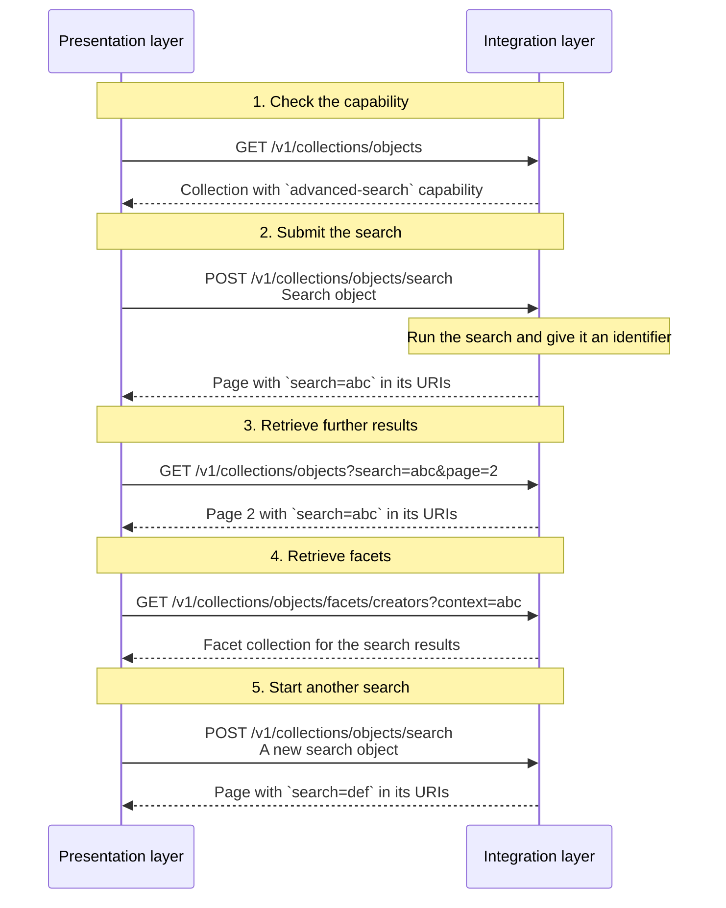

# Search

## Introduction

Search is crucial to help the users of presentation layers find information. A search is tied to a particular collection — the context collection — ensuring that results remain within the context of that collection. A presentation layer can search the items of that collection in two ways: with a **simple search** or with an **advanced search**. The presentation layer decides which form to use. A simple search works well for a keyword query with a sort order. An advanced search is needed when the search includes filters, such as date ranges, geolocation or facet values.

Both forms of search are optional. An integration layer _MAY_ implement simple search, advanced search, or both, depending on its requirements.

## Simple search

A simple search lets a user find items in a collection with a keyword query and a sort order. It is meant for quick, straightforward filtering.

A simple search uses the `GET` method. Its `q`, `orderBy`, `size` and `page` query parameters are added to a collection endpoint.

A collection that supports a simple search advertises the `https://specs.nde.nl/rest/v1/simple-search` capability.

## Advanced search

An advanced search lets a user narrow down the items of a collection with filters, such as date ranges, geolocation and facet values, combined with 'and' and 'or'. It can combine these filters with a keyword query, a sort order and a page size.

An advanced search uses the `POST` method. The presentation layer sends its search criteria in a JSON body, the **search object**. The `GET` method with a query string is not a good fit for complex criteria: it has a limited length, and conditions with 'and' and 'or' are hard to read and to parse.

A collection that supports an advanced search advertises the `https://specs.nde.nl/rest/v1/advanced-search` capability.

### Search object

A search object is a JSON object. It contains the search criteria of an advanced search.

The search object is an abstraction over query notations that developers may already know, such as Elasticsearch's query language or SQL. The abstraction is essential: an integration layer chooses its own backing store — this specification cannot prescribe the notation of one search engine or database. No suitable standard notation exists that the specification can adopt, so the search object defines a custom one. The notation is designed for a straightforward mapping to the native notation of a backing store.

A search object has the following properties:

| Name                  | Data type | Cardinality | Description                                                                                                                                                                                                                                                                                                                                                                  |
| --------------------- | --------- | ----------- | ---------------------------------------------------------------------------------------------------------------------------------------------------------------------------------------------------------------------------------------------------------------------------------------------------------------------------------------------------------------------------- |
| `q`                   | string    | 0 or 1      | A keyword query. It has the same meaning as the `q` query parameter of a [simple search](#endpoint-simple-search).                                                                                                                                                                                                                                                           |
| `orderBy`             | array     | 0 or 1      | An ordered list of sort criteria. The criteria apply in array order. If absent, the integration layer defines the order. It has the same meaning as the `orderBy` query parameter of a [simple search](#endpoint-simple-search).                                                                                                                                             |
| `orderBy[*]`          | object    | 1           | A sort criterion.                                                                                                                                                                                                                                                                                                                                                            |
| `orderBy[*].property` | string    | 1           | The property to sort on. It _MUST_ be one of the properties that the collection supports for sorting. Which properties a collection supports, and what they mean, is documented with that collection.                                                                                                                                                                        |
| `orderBy[*].order`    | string    | 1           | The direction of the sort. It _MUST_ be `asc` or `desc`.                                                                                                                                                                                                                                                                                                                     |
| `size`                | number    | 0 or 1      | The maximum number of items to retrieve. It has the same meaning as the `size` query parameter of a [simple search](#endpoint-simple-search).                                                                                                                                                                                                                                |
| `filter`              | object    | 0 or 1      | A condition that filters the items. See [Filters](#filters).                                                                                                                                                                                                                                                                                                                 |
| `facets`              | array     | 0 or 1      | The facet collections whose results the integration layer must return. See [Facets](facets.md).                                                                                                                                                                                                                                                                              |
| `context`             | string    | 0 or 1      | An identifier for an [advanced search](#endpoint-advanced-search) of the context collection. It is used only by facet collections and suggestion collections, to select the items on which their own items are based. The identifier _MUST_ identify an advanced search of that context collection; otherwise the integration layer _MUST_ respond with a `400` status code. |

An example of a search object:

```json
{
  "q": "rembrandt",
  "orderBy": [
    {
      "property": "relevance",
      "order": "desc"
    }
  ],
  "size": 20
}
```

The example searches the collection for items that match the keyword query `rembrandt`, returns 20 items per page, and sorts them by relevance, descending.

If the search object is invalid, or contains a filter that the collection does not support, the integration layer _MUST_ respond with a `400` status code.

:::note To do

Think of a way to express the ID of a `facet` in a search object. A facet ID like `creators` is a shorthand for its full URI but currently does not have a designated property in a [facet collection](facets.md#endpoint-retrieve-a-facet-collection). Full URIs — such as `https://example.org/v1/collections/masterpieces/facets/creators` — are rather verbose.

:::

### Filters

A presentation layer can narrow down the items of a collection with filters. Filters are part of a [search object](#search-object). A presentation layer sends filters in the `filter` property of a search object to the advanced search endpoint.

The filters a collection supports depend on the resources it holds. A [curated collection](collections.md) of entities with geographical data may support a geolocation filter. A [facet collection](facets.md) does not, because its items are facet items rather than entities with a location.

This specification describes the following filter types:

1. **Keyword filter**: matching text with `eq`, `startsWith`, `contains` or `similarTo` (e.g. 'Name starts with "Rem"').
1. **Date filter**: comparing dates with `eq`, `between`, `gt`, `gte`, `lt` or `lte` (e.g. 'Date of creation is between 1900 and 1950').
1. **Numeric filter**: comparing numbers with `eq`, `between`, `gt`, `gte`, `lt` or `lte` (e.g. 'Number of pages is at least 300').
1. **Geolocation filter**: matching a location with `withinRadius`, `withinBoundingBox` or `withinPolygon` (e.g. 'Location of creation is within 25 km of a point').
1. **Facet filter**: matching the values of one of the collection's facets with `eq`, `in`, `all` or `none` (e.g. 'Creator is "Rembrandt" or "Vincent van Gogh" and Type is "Painting"').
1. **Set filter**: matching all or none of a set of values with `all` or `none` (e.g. 'Creator includes both "Rembrandt" and "Vincent van Gogh"').
1. **Existence filter**: checking whether a property has a value with `exists` (e.g. 'Has a date of creation').

All filter types use the same syntax. They differ only in the operators that apply and in the type of the `value` that those operators expect.

A presentation layer _MUST_ only send filters that the collection supports. If it sends another filter, the integration layer _MUST_ respond with a `400` status code. Ignoring an unsupported filter would silently give the presentation layer more items than it asked for.

#### Conditions

The `filter` property holds a **condition**. A condition is one of two kinds:

- A **boolean condition** combines other conditions with `and`, `or` or `not`.
- A **property condition** compares a property of an item with a value.

Every comparison is an object with `property`, `operator` and `value`. This shape is straightforward to validate and to translate to the notation of the backing store.

A condition _MUST_ contain exactly one of `and`, `or`, `not` or `property`.

A boolean condition has one of these forms:

| Name  | Data type | Cardinality | Description                                                       |
| ----- | --------- | ----------- | ----------------------------------------------------------------- |
| `and` | array     | 1           | Matches an item when every condition in the array matches.        |
| `or`  | array     | 1           | Matches an item when at least one condition in the array matches. |
| `not` | object    | 1           | Matches an item when the condition does not match.                |

The value of `and` or `or` _MUST_ be an array with at least one condition. The value of `not` _MUST_ be exactly one condition. Conditions can be nested. The integration layer _MAY_ limit the nesting depth.

A property condition contains three members:

| Property   | Data type | Cardinality | Description                                                                                              |
| ---------- | --------- | ----------- | -------------------------------------------------------------------------------------------------------- |
| `property` | string    | 1           | The property to compare. It _MUST_ be one of the properties that the collection documents as filterable. |
| `operator` | string    | 1           | How to compare the property with the value. See [Operators](#operators).                                 |
| `value`    | any       | 1           | The value to compare with. Its type depends on the operator and on the property.                         |

If the property holds multiple values, a property condition matches an item when at least one of the values matches. This applies to properties such as `creator`, which can hold several entities. The operators `all` and `none` are the exception: they compare the complete set of values, as described in [Operators](#operators).

A property condition on its own looks like this:

```json
{
  "property": "creator",
  "operator": "eq",
  "value": "https://example.org/v1/entities/1234"
}
```

Put in the `filter` property of a search object, it matches items that have that creator.

#### Operators

An operator defines how a [property condition](#conditions) compares the property with the value, such as 'equals', 'is greater than' or 'starts with'.

This specification defines common operators. The operator names and their value shapes are extensible: an integration layer _MAY_ support more operators, and later versions of this specification _MAY_ add them.

An integration layer _MUST_ document the operators that a collection supports. A filter capability, such as `https://specs.nde.nl/rest/v1/geolocation-filter`, means that the collection supports at least one operator of that filter type, not that it supports all of them. A presentation layer _MUST NOT_ use an operator that the collection does not document. If it does, the integration layer _MUST_ respond with a `400` status code.

| Operator            | Value                                           | Matches when the property                                                                                                                                                                                                   |
| ------------------- | ----------------------------------------------- | --------------------------------------------------------------------------------------------------------------------------------------------------------------------------------------------------------------------------- |
| `eq`                | string, number or boolean                       | equals the value                                                                                                                                                                                                            |
| `in`                | non-empty array of strings, numbers or booleans | equals one of the values. The values _MUST_ all be of the same type.                                                                                                                                                        |
| `all`               | non-empty array of strings, numbers or booleans | contains every one of the values. The values _MUST_ all be of the same type. For a property with a single value, `all` with one value is the same as `in`.                                                                  |
| `none`              | non-empty array of strings, numbers or booleans | contains none of the values. The values _MUST_ all be of the same type. For a property with a single value, `none` is the same as the negation of `in`.                                                                     |
| `exists`            | boolean                                         | has a value when the value is `true`, and no value when the value is `false`. A property has a value when the item contains it and its value is not `null`. For a multi-valued property, an empty array counts as no value. |
| `startsWith`        | string                                          | starts with the value                                                                                                                                                                                                       |
| `contains`          | string                                          | contains the value                                                                                                                                                                                                          |
| `similarTo`         | string                                          | is similar to the value. The integration layer defines how similar, e.g. by ignoring case and minor spelling differences.                                                                                                   |
| `gt`                | number or date                                  | is greater than the value                                                                                                                                                                                                   |
| `gte`               | number or date                                  | is greater than or equal to the value                                                                                                                                                                                       |
| `lt`                | number or date                                  | is less than the value                                                                                                                                                                                                      |
| `lte`               | number or date                                  | is less than or equal to the value                                                                                                                                                                                          |
| `between`           | array of two numbers or two dates               | is equal to or greater than the first value and equal to or less than the second value. The first value _MUST_ be less than or equal to the second value.                                                                   |
| `withinRadius`      | object                                          | is a location within a distance of a point. See [Geolocation](#geolocation).                                                                                                                                                |
| `withinBoundingBox` | object                                          | is a location inside a bounding box. See [Geolocation](#geolocation).                                                                                                                                                       |
| `withinPolygon`     | object                                          | is a location inside a polygon. See [Geolocation](#geolocation).                                                                                                                                                            |

The sections below describe how the operators apply to each data type. The `exists` operator applies to a property of any data type; the other operators apply to the data types listed in the Value column.

#### Strings

A keyword filter compares a string property. String properties support `eq`, `in`, `all`, `none`, `startsWith`, `contains` and `similarTo`. The value is a string, or an array of strings for `in`, `all` and `none`.

Whether a string comparison is case-sensitive is defined by the integration layer, depending on its requirements. `startsWith` looks for the value at the start of the property. `contains` looks for it anywhere in the property. For `similarTo`, the integration layer also defines how similar two values must be, for example by ignoring case and minor spelling differences.

```json
{
  "property": "name",
  "operator": "startsWith",
  "value": "Rem"
}
```

For a facet filter, each value is the `id` of the facet item when it has one, and its `name` otherwise. See [Facet items](facets.md#facet-items).

#### Numbers

A numeric filter compares a number property. Numeric properties support `eq`, `in`, `all`, `none`, `gt`, `gte`, `lt`, `lte` and `between`. The value is a number, or an array of numbers for `in`, `all`, `none` and `between`.

`gt`, `gte`, `lt` and `lte` compare the property with one boundary. `between` compares it with two boundaries and includes both: an item that equals either boundary matches.

```json
{
  "property": "numberOfPages",
  "operator": "between",
  "value": [200, 300]
}
```

#### Dates

A date filter compares a date property. Date properties support the same operators as number properties: `eq`, `in`, `all`, `none`, `gt`, `gte`, `lt`, `lte` and `between`. A date value is a string in [ISO 8601](https://en.wikipedia.org/wiki/ISO_8601) format, such as `1900`, `1900-01` or `1900-01-01`, and can therefore name a year, a month or a day.

As with numbers, `between` includes both boundaries.

```json
{
  "property": "dateCreated",
  "operator": "between",
  "value": ["1900", "1950"]
}
```

#### Booleans

A boolean property supports `eq` and `in`. The value is `true` or `false`.

```json
{
  "property": "isAccessibleForFree",
  "operator": "eq",
  "value": true
}
```

#### Geolocation

A geolocation filter uses a property that the collection documents as a location, such as the place where an item was created or a set of coordinates. Location properties support `withinRadius`, `withinBoundingBox` and `withinPolygon`. Latitude and longitude are in decimal degrees. The integration layer resolves that property to coordinates.

`withinRadius` takes a point, a distance and a unit:

```json
{
  "property": "locationCreated",
  "operator": "withinRadius",
  "value": {
    "latitude": 52.0148856,
    "longitude": 4.3475369,
    "distance": 25,
    "unit": "km"
  }
}
```

The `distance` _MUST_ be greater than 0. The `unit` _MUST_ be `km` (kilometres) or `m` (metres).

`withinBoundingBox` takes the south-west and north-east corners of a box. This example uses a box around the city centre of Delft, the Netherlands:

```json
{
  "property": "locationCreated",
  "operator": "withinBoundingBox",
  "value": {
    "southWest": {
      "latitude": 52.005,
      "longitude": 4.35
    },
    "northEast": {
      "latitude": 52.018,
      "longitude": 4.368
    }
  }
}
```

Each corner has a `latitude` and a `longitude`. The latitude of the south-west corner _MUST_ be less than or equal to the latitude of the north-east corner, and its longitude _MUST_ be less than or equal to the longitude of the north-east corner.

`withinPolygon` takes a polygon. The value is an object with a `points` array of at least three points, each with a `latitude` and a `longitude`:

```json
{
  "property": "locationCreated",
  "operator": "withinPolygon",
  "value": {
    "points": [
      {
        "latitude": 52.005,
        "longitude": 4.35
      },
      {
        "latitude": 52.018,
        "longitude": 4.35
      },
      {
        "latitude": 52.0115,
        "longitude": 4.368
      }
    ]
  }
}
```

The polygon is closed automatically: the first point does not have to be repeated at the end. The integration layer defines whether a location on the boundary counts as inside.

#### Examples of filters

A filter with nested `and` and `not` conditions:

```json
{
  "filter": {
    "and": [
      {
        "property": "dateCreated",
        "operator": "between",
        "value": ["1600", "1700"]
      },
      {
        "property": "creator",
        "operator": "in",
        "value": [
          "https://example.org/v1/entities/7890",
          "https://example.org/v1/entities/9012"
        ]
      },
      {
        "not": {
          "property": "additionalType",
          "operator": "eq",
          "value": "https://example.org/v1/entities/1122"
        }
      }
    ]
  }
}
```

The filter matches items that were created between 1600 and 1700, have one of two creators, and are not of type 'Painting'.

Another example, with geolocation filters:

```json
{
  "filter": {
    "or": [
      {
        "and": [
          {
            "property": "locationCreated",
            "operator": "withinRadius",
            "value": {
              "latitude": 52.3676,
              "longitude": 4.9041,
              "distance": 25,
              "unit": "km"
            }
          },
          {
            "property": "name",
            "operator": "startsWith",
            "value": "De"
          }
        ]
      },
      {
        "and": [
          {
            "property": "locationCreated",
            "operator": "withinBoundingBox",
            "value": {
              "southWest": {
                "latitude": 52.005,
                "longitude": 4.35
              },
              "northEast": {
                "latitude": 52.018,
                "longitude": 4.368
              }
            }
          },
          {
            "property": "numberOfPages",
            "operator": "gte",
            "value": 300
          }
        ]
      }
    ]
  }
}
```

The filter matches items that are either within 25 km of a point and have a name that starts with 'De', or lie inside a bounding box around Delft and have at least 300 pages.

A filter can combine string conditions in the same way:

```json
{
  "filter": {
    "or": [
      {
        "property": "name",
        "operator": "eq",
        "value": "The Night Watch"
      },
      {
        "property": "description",
        "operator": "contains",
        "value": "Rembrandt"
      },
      {
        "property": "name",
        "operator": "similarTo",
        "value": "Nite Watch"
      }
    ]
  }
}
```

The filter matches items whose name or description matches one of several string conditions.

#### Translating filters

The syntax is designed to translate directly to the native query language of a backing store. The table shows the closest equivalent of each condition. It is illustrative, not prescriptive: stores differ between versions, and an integration layer can preprocess data or evaluate a condition in application code when there is no native equivalent.

| Condition                | Elasticsearch                                | Typesense `filter_by`                                                        | PostgreSQL                         |
| ------------------------ | -------------------------------------------- | ---------------------------------------------------------------------------- | ---------------------------------- |
| `and`                    | `bool.must`                                  | `&&`                                                                         | `AND`                              |
| `or`                     | `bool.should` with `minimum_should_match: 1` | `\|\|`                                                                       | `OR`                               |
| `not`                    | `bool.must_not`                              | `property:!=value`; otherwise negate the condition                           | `NOT`                              |
| `eq`                     | `term` or `match`                            | `property:=value`                                                            | `property = value`                 |
| `in`                     | `terms`                                      | `property:=[a, b]`                                                           | `property IN (a, b)`               |
| `all`                    | `bool.must` with one `term` per value        | `property:=a && property:=b`                                                 | `property @> ARRAY[a, b]`          |
| `none`                   | `bool.must_not` with `terms`                 | `property:!=[a, b]`                                                          | `NOT (property @> ARRAY[a, b])`    |
| `exists`                 | `exists`                                     | not native; index a boolean flag                                             | `property IS NOT NULL`             |
| `between`                | `range` with `gte` and `lte`                 | `property:[a..b]`                                                            | `property BETWEEN a AND b`         |
| `gt`, `gte`, `lt`, `lte` | `range` with the same name                   | `property:>value`, `property:>=value`, `property:<value`, `property:<=value` | `>`, `>=`, `<`, `<=`               |
| `startsWith`             | `prefix`                                     | `property:value*`                                                            | `property LIKE 'value%'`           |
| `contains`               | `wildcard` with `*value*`                    | `property:*value*` (requires an infix index)                                 | `property LIKE '%value%'`          |
| `similarTo`              | `match` with `fuzziness`                     | not native; use the query's typo tolerance                                   | `similarity()` from `pg_trgm`      |
| `withinRadius`           | `geo_distance`                               | `property:(lat, lon, distance unit)`                                         | `ST_DWithin` from PostGIS          |
| `withinBoundingBox`      | `geo_bounding_box`                           | `property:(...)` polygon with the four corners                               | `ST_Within` with `ST_MakeEnvelope` |
| `withinPolygon`          | `geo_shape` with a polygon                   | `property:(...)` polygon with the corners                                    | `ST_Within` with `ST_GeomFromText` |

The choice between `term` and `match` in Elasticsearch depends on how the property is indexed: `term` for an exact value such as a keyword or an identifier, `match` for analysed text. PostgreSQL's `LIKE` is case-sensitive; an integration layer that needs case-insensitive matching can use `ILIKE`. The `pg_trgm` extension provides `similarTo`, and PostGIS provides the geolocation filters.

### Search identifier

An advanced search needs an identifier, because a presentation layer cannot repeat the search criteria in later requests. It sends the criteria in the body of the `POST` request that starts the search, but it retrieves pages and facets with `GET` requests, which have no request body. The identifier lets the presentation layer refer to the same search in those requests.

The integration layer returns the identifier in the response URIs of the advanced search. In those URIs, it appears as the `search` query string parameter: that parameter is the protocol implementation of the identifier.

An identifier is opaque. A presentation layer _MUST NOT_ try to interpret it, build it or change it. It _MUST_ pass the value back unchanged in every subsequent request.

The integration layer connects the identifier to the search object. It can do that in two ways:

- **Stateless**: the integration layer encodes the search object in the identifier itself. It _MAY_ compress, sign or encrypt the value. It _MAY_ also use a plain encoding, such as Base64URL, as long as it validates the decoded search object before using it. For example, the identifier may be the JSON search object compressed and then encoded with Base64URL.
- **Stateful**: the integration layer stores the search object on its server and gives the identifier a value that refers to it. It manages the lifecycle of the stored object itself, such as its expiry date. For example, the identifier may be a random UUID that the integration layer uses as the key of the stored search object in a database.

Both implementations look the same to a presentation layer. The specification does not prescribe which one an integration layer uses.

An identifier is bound to the collection and to the search object. A presentation layer _MUST NOT_ use it with another collection or with another advanced search. If it does, the integration layer _MUST_ respond with a `400` status code.

The identifier _MUST_ appear in every URI that navigates the search results: the `id` of the page, `prev.id`, `next.id`, `partOf.id`, `partOf.first.id` and `partOf.last.id`. It _MUST_ also appear in the `first.id` and `last.id` of the filtered collection.

The `search` parameter and the simple search parameters (`q`, `orderBy`, `size`) are mutually exclusive. A presentation layer _MUST NOT_ combine them in one request. If it does, the integration layer _MUST_ respond with a `400` status code.

A [facet collection](facets.md) and a [suggestion collection](suggestions.md) can also use the `context` parameter. It holds the identifier of an advanced search of the collection's context collection. It is independent of the `search` parameter: `search` refers to an advanced search of the collection itself, while `context` refers to an advanced search of its context collection. See the search context of [facet collections](facets.md#search-context) and [suggestion collections](suggestions.md#search-context).

:::note To be discussed

A filtered collection is a view with its own `id`, `totalItems` and pages. Is it part of the collection tree, or a separate, temporary resource? And how long must the identifier remain valid? A URI that contains an identifier is only dereferenceable while the integration layer knows the search object. Should the specification define a minimum lifetime, and what should the integration layer return after that (e.g. `410 Gone`)?

:::

## Sorting

A search result has an order. Sorting determines that order by arranging the matching items according to one or more criteria, in priority order. The first criterion determines the main order. Each following criterion decides the order of items that the previous criteria consider equal.

A sort criterion has two parts: what to sort on, and the direction, ascending or descending. What to sort on can be how relevant an item is to the search, a value of the item itself, or another property that the collection defines.

Sorting changes only the order of the results. It does not change which items match the search.

If no order is specified, the integration layer defines a default order. Which properties a collection supports for sorting, and what they mean, is documented with that collection.

## Simple search and advanced search compared

| Aspect           | Simple search                                         | Advanced search                                                                                                     |
| ---------------- | ----------------------------------------------------- | ------------------------------------------------------------------------------------------------------------------- |
| How              | `GET` with `q`, `orderBy` and `size` query parameters | `POST` with a [search object](search.md#search-object)                                                              |
| Capability       | `https://specs.nde.nl/rest/v1/simple-search`          | `https://specs.nde.nl/rest/v1/advanced-search`                                                                      |
| Supports filters | No                                                    | Yes                                                                                                                 |
| Pagination       | `GET` with the same query parameters                  | `GET` with the `search` parameter                                                                                   |
| Cacheable        | Yes                                                   | Depends: a stateless identifier is reusable; a stateful one may expire, so responses cannot be cached indefinitely. |
| Bookmarkable     | Yes                                                   | Depends: a stateless identifier keeps working; a stateful one may expire, so a bookmark can stop working.           |

## Endpoint: Simple search

A simple search is not a separate endpoint. It uses the endpoint that retrieves a collection or a page. For example, a simple search can be applied to a [curated collection](collections.md#endpoint-retrieve-a-collection) or to a [page in that collection](collections.md#endpoint-retrieve-a-page-in-a-collection).

### HTTP request

`GET /{version}/{...collections}?q={q}&orderBy={orderBy}&size={size}&page={page}`

### Path parameters

| Name             | Data type | Cardinality | Description                                                                       |
| ---------------- | --------- | ----------- | --------------------------------------------------------------------------------- |
| `version`        | string    | 1           | The version of the API. Example: `v1`.                                            |
| `...collections` | string    | 1 or more   | The path identifier(s) of the context collection. Example: `collections/objects`. |

### Query parameters

| Name      | Data type | Cardinality | Description                                                                                                                                                                                                                                                                                                                                                                                                                                                                                                                                               |
| --------- | --------- | ----------- | --------------------------------------------------------------------------------------------------------------------------------------------------------------------------------------------------------------------------------------------------------------------------------------------------------------------------------------------------------------------------------------------------------------------------------------------------------------------------------------------------------------------------------------------------------- |
| `q`       | string    | 0 or 1      | A keyword query for filtering the items. The integration layer defines the minimum and maximum length and how the query is matched.                                                                                                                                                                                                                                                                                                                                                                                                                       |
| `orderBy` | string    | 0 or 1      | The sorting order of the items: a comma-separated list of sort criteria, in priority order. Each criterion is `property` or `property:order`, where `property` is `relevance` or `value` and `order` is `asc` or `desc`. Example: `relevance:desc,value:asc`. `relevance` typically expresses how well an item matches the keyword query (`q`). An integration layer _MAY_ also apply its own relevance rules when `q` is missing. The integration layer defines which property `value` sorts on (e.g. the `name` of an entity). See [Sorting](#sorting). |
| `size`    | number    | 0 or 1      | The maximum number of items to retrieve. The minimum is 1. The integration layer defines the maximum.                                                                                                                                                                                                                                                                                                                                                                                                                                                     |
| `page`    | string    | 0 or 1      | The page to retrieve: a page number or a cursor, depending on the [pagination strategy](resources.md#page-navigation-and-cursor-navigation). Required when retrieving a page.                                                                                                                                                                                                                                                                                                                                                                             |

### Request body

None.

### Response body

The response is a `Page` if the collection is divided into pages; otherwise it is a `Collection` with its items inline.

### Example

An example request from a presentation layer:

```http
GET /v1/collections/masterpieces?q=rembrandt&orderBy=relevance:desc,value:asc
Host: example.org
```

This tells the integration layer that the presentation layer is searching for resources in the 'Masterpieces' collection that match the keyword 'rembrandt' and that matching resources must be ordered by relevance, descending, and then by value, ascending.

An example of the response of the integration layer:

```json
{
  "@context": "https://example.org/v1/context.json",
  "id": "https://example.org/v1/collections/masterpieces?q=rembrandt&orderBy=relevance:desc,value:asc&page=1",
  "type": "Page",
  "name": "Masterpieces: page 1",
  "items": [
    {
      "id": "https://example.org/v1/entities/1234",
      "type": "HeritageObject",
      "name": "The Night Watch"
    }
    // Other items...
  ],
  "next": {
    "id": "https://example.org/v1/collections/masterpieces?q=rembrandt&orderBy=relevance:desc,value:asc&page=2",
    "type": "Page"
  },
  "partOf": {
    "id": "https://example.org/v1/collections/masterpieces?q=rembrandt&orderBy=relevance:desc,value:asc",
    "type": "CuratedCollection",
    "name": "Masterpieces",
    "totalItems": 42,
    "first": {
      "id": "https://example.org/v1/collections/masterpieces?q=rembrandt&orderBy=relevance:desc,value:asc&page=1",
      "type": "Page"
    },
    "last": {
      "id": "https://example.org/v1/collections/masterpieces?q=rembrandt&orderBy=relevance:desc,value:asc&page=3",
      "type": "Page"
    }
  }
}
```

The response indicates that the simple search has 42 results, that this is the first page, and that the next page is page 2.

## Endpoint: Advanced search

### HTTP request

`POST /{version}/{...collections}/search`

:::note

The `search` path segment is a verb rather than a noun. This is an explicit exception, allowed by the [REST API Design Rules](https://logius-standaarden.github.io/API-Design-Rules/#/core/resource-operations).

:::

### Path parameters

| Name             | Data type | Cardinality | Description                                                                       |
| ---------------- | --------- | ----------- | --------------------------------------------------------------------------------- |
| `version`        | string    | 1           | The version of the API. Example: `v1`.                                            |
| `...collections` | string    | 1 or more   | The path identifier(s) of the context collection. Example: `collections/objects`. |

### Query parameters

None.

### Request body

The request body _MUST_ contain a JSON-formatted [search object](#search-object).

### Response body

The response is a `Page` if the collection is divided into pages; otherwise it is a `Collection` with its items inline. The response URIs contain the [search identifier](#search-identifier).

### Example

An example request from a presentation layer:

```http
POST /v1/collections/masterpieces/search
Host: example.org
Content-Type: application/json

{
  "q": "rembrandt",
  "orderBy": [
    {
      "property": "relevance",
      "order": "asc"
    }
  ]
}
```

This tells the integration layer that the presentation layer is searching for resources in the 'Masterpieces' collection that match the keyword 'rembrandt' and that matching resources must be ordered by relevance, ascending.

An example of the response of the integration layer:

```json
{
  "@context": "https://example.org/v1/context.json",
  "id": "https://example.org/v1/collections/masterpieces?search=abc&page=1",
  "type": "Page",
  "name": "Masterpieces: page 1",
  "items": [
    {
      "id": "https://example.org/v1/entities/1234",
      "type": "HeritageObject",
      "name": "The Night Watch"
    }
    // Other items...
  ],
  "next": {
    "id": "https://example.org/v1/collections/masterpieces?search=abc&page=2",
    "type": "Page"
  },
  "partOf": {
    "id": "https://example.org/v1/collections/masterpieces?search=abc",
    "type": "CuratedCollection",
    "name": "Masterpieces",
    "totalItems": 42,
    "first": {
      "id": "https://example.org/v1/collections/masterpieces?search=abc&page=1",
      "type": "Page"
    },
    "last": {
      "id": "https://example.org/v1/collections/masterpieces?search=abc&page=3",
      "type": "Page"
    }
  }
}
```

The response indicates that the advanced search has 42 results, that this is the first page, and that the next page is page 2. The `search` parameter in the URIs of properties `id`, `next.id`, `partOf.id`, `partOf.first.id` and `partOf.last.id` is an identifier for a search object.

## Anatomy of an advanced search

An advanced search takes several requests. A presentation layer starts the search with one request and then uses the search identifier that the response contains to retrieve further results.

The steps below use a collection that is divided into pages as an example. If the integration layer returns the full collection instead, some steps differ: there are no page URIs to follow, but the identifier still appears in the URIs of the collection.

1. **Check that the collection supports an advanced search.** The collection advertises the `https://specs.nde.nl/rest/v1/advanced-search` capability.
2. **Submit the search.** A presentation layer sends a `POST` request with a [search object](#search-object) to the search endpoint of the collection. The integration layer runs the search and returns the first results as a `Page`, or as a `Collection` if it does not divide the collection into pages. It gives the search an identifier and includes it as the `search` parameter in every URI that refers to the search.
3. **Retrieve further results.** If the collection is divided into pages, a presentation layer follows a page URI from the response, such as `next.id`, or adds the `page` query parameter to the `partOf.id` URI. It passes the `search` parameter unchanged. It does not send the search object again: the identifier already refers to it.
4. **Retrieve facets (optional).** A presentation layer requests a [facet collection](facets.md) with the `context` parameter set to the identifier of the advanced search of the collection. The facet items and their counts then cover only the items that match the search. The `search` parameter of the facet collection refers to an advanced search of the facet collection itself, not to the context collection.
5. **Start another search.** A new search is a new `POST` request with a new search object. It gets its own identifier. An identifier is bound to its collection and its search object; it cannot be used for another collection or another search.

The integration layer may keep the search object on its server or encode it in the identifier. The presentation layer does not need to know which; it only passes the identifier back.

The following sequence diagram shows the requests for this paginated example:


