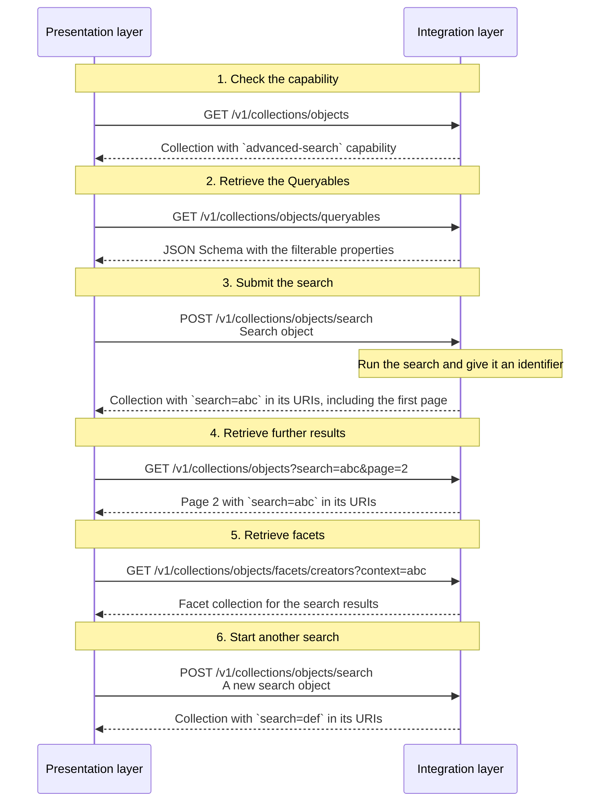

# Search

## Introduction

Search is crucial to help the users of presentation layers find information. A search is tied to a particular collection — the context collection — ensuring that results remain within the context of that collection. A presentation layer can search the items of that collection in two ways: with a **simple search** or with an **advanced search**. A simple search works well for a keyword query with a sort order. An advanced search is needed when the search includes filters, such as date ranges, geolocation or facet values.

Both forms of search are optional. An integration layer _MAY_ implement simple search, advanced search, or both, depending on its requirements.

## Simple search

A simple search lets a user find items in a collection with a keyword query and a sort order. It is meant for quick, straightforward filtering.

A simple search uses the `GET` method. Its `q`, `orderBy`, `size` and `page` query parameters are added to a collection endpoint.

A collection that supports a simple search advertises the `https://specs.nde.nl/rest/v1/simple-search` capability.

## Advanced search

An advanced search lets a user narrow down the items of a collection with filters, such as date ranges, geolocation and facet values, combined with 'and' and 'or'. It can combine these filters with a keyword query, a sort order and a page size.

An advanced search uses the `POST` method. The presentation layer sends its search criteria in a JSON body, the **search object**. It does not use the `GET` method: a query string is a poor fit for complex criteria: it has a limited length, and it must be URL-encoded, which makes the criteria hard to read and easy to get wrong.

A collection that supports an advanced search advertises the `https://specs.nde.nl/rest/v1/advanced-search` capability. It also exposes a [Queryables resource](#queryables), which lists the properties that a filter may use.

### Search object

A search object is a JSON object. It contains the search criteria of an advanced search.

The search object is an abstraction over query languages that developers may already know, such as Elasticsearch's query language or SQL. The abstraction is essential: an integration layer chooses its own backing store, and this specification cannot prescribe the query language of one search engine or database. For filters, the search object uses the standard [Common Query Language (CQL2)](https://docs.ogc.org/is/21-065r2/21-065r2.html); the other search criteria are defined by this specification. The search object is designed for a straightforward mapping to the native query language of a backing store.

A search object has the following properties:

| Name                  | Data type | Cardinality | Description                                                                                                                                                                                                                                                                                                                                                                  |
| --------------------- | --------- | ----------- | ---------------------------------------------------------------------------------------------------------------------------------------------------------------------------------------------------------------------------------------------------------------------------------------------------------------------------------------------------------------------------- |
| `q`                   | string    | 0 or 1      | A keyword query. It has the same meaning as the `q` query parameter of a [simple search](#endpoint-simple-search). When the search object also has a `filter`, an item _MUST_ match both.                                                                                                                                                                                    |
| `orderBy`             | array     | 0 or 1      | An ordered list of sort criteria. The criteria apply in array order. If absent, the integration layer defines the order. It has the same meaning as the `orderBy` query parameter of a [simple search](#endpoint-simple-search).                                                                                                                                             |
| `orderBy[*]`          | object    | 1           | A sort criterion.                                                                                                                                                                                                                                                                                                                                                            |
| `orderBy[*].property` | string    | 1           | The property to sort on. It _MUST_ be one of the properties that the collection supports for sorting. Which properties a collection supports, and what they mean, is documented with that collection.                                                                                                                                                                        |
| `orderBy[*].order`    | string    | 1           | The direction of the sort. It _MUST_ be `asc` or `desc`.                                                                                                                                                                                                                                                                                                                     |
| `size`                | number    | 0 or 1      | The maximum number of items to retrieve. It has the same meaning as the `size` query parameter of a [simple search](#endpoint-simple-search).                                                                                                                                                                                                                                |
| `filter`              | object    | 0 or 1      | A CQL2 filter expression. See [Filters](#filters).                                                                                                                                                                                                                                                                                                                           |
| `context`             | string    | 0 or 1      | An identifier for an [advanced search](#endpoint-advanced-search) of the context collection. It is used only by facet collections and suggestion collections, to select the items on which their own items are based. The identifier _MUST_ identify an advanced search of that context collection; otherwise the integration layer _MUST_ respond with a `400` status code. |

`q` and `filter` are complementary. `q` is a keyword query: it matches text across a set of properties that the integration layer defines, and it produces the relevance score that an `orderBy` criterion can use. `filter` is a boolean condition over the properties that the Queryables resource declares; it selects items but does not affect their relevance. An integration layer _MUST_ combine them with a logical AND: an item is included only if it matches the keyword query and satisfies the filter. A text filter is not a substitute for `q`, because it targets one property and does not rank.

An example of a search object:

```json
{
  "q": "rembrandt",
  "orderBy": [
    {
      "property": "relevance",
      "order": "desc"
    }
  ],
  "size": 20
}
```

The example searches the collection for items that match the keyword query `rembrandt`, returns 20 items per page, and sorts them by relevance, descending.

If the search object is invalid, or contains a filter with an operator or property that the API does not support, the integration layer _MUST_ respond with a `400` status code.

:::note To do

Think of a way to express the ID of a `facet` in a search object. A facet ID like `creators` is a shorthand for its full URI but currently does not have a designated property in a [facet collection](facets.md#endpoint-retrieve-a-facet-collection). Full URIs — such as `https://example.org/v1/collections/masterpieces/facets/creators` — are rather verbose.

:::

### Filters

A presentation layer can narrow down the items of a collection with filters. Filters are part of a [search object](#search-object). A presentation layer sends filters in the `filter` property of a search object to the advanced search endpoint.

This specification uses the [Common Query Language (CQL2)](https://docs.ogc.org/is/21-065r2/21-065r2.html) for filters, in its JSON encoding. It has a [JSON Schema](https://schemas.opengis.net/cql2/1.0/cql2.json) which integration layers and presentation layers can use to validate a filter before executing or sending it. It also has an ecosystem of programming libraries for building, parsing and validating filters. An integration layer translates a CQL2 filter to the native query language of its backing store.

Which filters a collection supports is described in two places. The [conformance declaration](#conformance) of the API lists the CQL2 operators that the API supports. The [Queryables resource](#queryables) of the collection lists the properties that a filter may use. Together they determine what a presentation layer can filter on. For example, a geolocation filter needs an operator such as `s_within` and a property with a geometry.

This specification describes the following filter types:

1. **Text filter**: matching text with `=`, `in` or `like` (e.g. 'Name starts with "Rem"').
1. **Date filter**: comparing dates with `=`, `in`, `>`, `>=`, `<` or `<=` (e.g. 'Date of creation is between 1900 and 1950').
1. **Numeric filter**: comparing numbers with `=`, `in`, `>`, `>=`, `<`, `<=` or `between` (e.g. 'Number of pages is at least 300').
1. **Geolocation filter**: matching a location with `s_within` and a bounding box or polygon (e.g. 'Location of creation is inside a bounding box around Delft').
1. **Facet filter**: matching the values of one of the collection's facets with `=`, `in`, `a_contains` or `not a_overlaps` (e.g. 'Creator is "Rembrandt" or "Vincent van Gogh" and Type is "Painting"').
1. **Set filter**: matching all or none of a set of values with `a_contains` or `not a_overlaps` (e.g. 'Creator includes both "Rembrandt" and "Vincent van Gogh"').

All filter types use the same CQL2 syntax. They differ only in the operators that apply and in the type of the operands that those operators expect.

A presentation layer _MUST_ only use operators that the API's [conformance declaration](#conformance) covers and properties that the collection's [Queryables resource](#queryables) declares. If it uses another operator or property, the integration layer _MUST_ respond with a `400` status code. Ignoring an unsupported filter would silently give the presentation layer more items than it asked for.

#### Conformance

Which CQL2 operators the integration layer supports is declared in its conformance declaration. An integration layer that supports filters _MUST_ publish such a declaration. It lists the [CQL2 conformance classes](https://docs.ogc.org/is/21-065r2/21-065r2.html#_conformance) that apply.

The conformance declaration _MUST_ include `http://www.opengis.net/spec/cql2/1.0/conf/cql2-json`, because this specification uses the JSON encoding of CQL2. It _MUST_ also include the class for every operator family that the API supports:

| Conformance class             | URI                                                                       | Adds                                                             |
| ----------------------------- | ------------------------------------------------------------------------- | ---------------------------------------------------------------- |
| Basic CQL2                    | `http://www.opengis.net/spec/cql2/1.0/conf/basic-cql2`                    | `and`, `or`, `not`, `=`, `<>`, `<`, `<=`, `>`, `>=` and `isNull` |
| Advanced Comparison Operators | `http://www.opengis.net/spec/cql2/1.0/conf/advanced-comparison-operators` | `like`, `between` and `in`                                       |
| Case-insensitive Comparison   | `http://www.opengis.net/spec/cql2/1.0/conf/case-insensitive-comparison`   | `casei`                                                          |
| Accent-insensitive Comparison | `http://www.opengis.net/spec/cql2/1.0/conf/accent-insensitive-comparison` | `accenti`                                                        |
| Spatial Functions             | `http://www.opengis.net/spec/cql2/1.0/conf/spatial-functions`             | `s_within` and the other spatial predicates                      |
| Temporal Functions            | `http://www.opengis.net/spec/cql2/1.0/conf/temporal-functions`            | `t_after`, `t_before` and the other temporal predicates          |
| Array Functions               | `http://www.opengis.net/spec/cql2/1.0/conf/array-functions`               | `a_contains`, `a_overlaps` and the other array predicates        |
| Functions                     | `http://www.opengis.net/spec/cql2/1.0/conf/functions`                     | Custom functions                                                 |

#### Filter expressions

The `filter` property holds one CQL2 expression. An expression is a JSON object. For example:

```json
{
  "op": "=",
  "args": [
    {
      "property": "creator"
    },
    "https://example.org/v1/entities/1234"
  ]
}
```

Put in the `filter` property of a search object, it matches items that have the creator with ID `https://example.org/v1/entities/1234`.

The integration layer _MUST_ validate the expression against the CQL2 JSON Schema, against the operators in the API's [conformance declaration](#conformance), and against the properties in the collection's [Queryables resource](#queryables). If the expression is invalid or contains an unsupported operator or property, the integration layer _MUST_ respond with a `400` status code.

#### Operators

CQL2 supports various operators. The table underneath lists examples of operators that an integration layer may support. It shows what each operator does in this API and which data types it applies to. The list is not exhaustive: an integration layer may also support other CQL2 operators and declare them in its [conformance declaration](#conformance).

| CQL2 operator or function | Applies to                           | Meaning                                                                                 |
| ------------------------- | ------------------------------------ | --------------------------------------------------------------------------------------- |
| `and`, `or`, `not`        | any                                  | Combine or negate filter expressions.                                                   |
| `=`                       | string, number, date, boolean, facet | Equals the value.                                                                       |
| `in`                      | string, number, date, boolean, facet | Equals one of the values.                                                               |
| `like`                    | string                               | Matches a pattern. `%` matches any sequence of characters; `_` matches one character.   |
| `between`                 | number                               | Is equal to or greater than the first value and equal to or less than the second value. |
| `>`, `>=`, `<`, `<=`      | number, date                         | Compares with the value.                                                                |
| `a_contains`              | multi-valued property                | Contains every one of the values.                                                       |
| `a_overlaps`              | multi-valued property                | Shares at least one value. Use `not a_overlaps` for 'contains none'.                    |
| `s_within`                | location                             | Is inside a bounding box or polygon.                                                    |

Operator support is the same for every collection: it follows from the conformance declaration, not from a capability of a collection. Property support differs per collection and is described by the collection's [Queryables resource](#queryables). A presentation layer _MUST NOT_ use an operator that the API does not declare, or a property that the collection's Queryables resource does not declare. If it does, the integration layer _MUST_ respond with a `400` status code.

#### Strings

A text filter compares a string property. In CQL2, string properties are compared with `=`, `in` and `like`. The `like` operator uses `%` as a wildcard for any sequence of characters and `_` for exactly one character. A pattern such as `Rem%` matches values that start with 'Rem'; `%Rem%` matches values that contain 'Rem'. For example:

```json
{
  "op": "like",
  "args": [
    {
      "property": "name"
    },
    "Rem%"
  ]
}
```

This filter matches items whose name starts with 'Rem'.

Whether a string comparison is case-sensitive is defined by the integration layer. CQL2 also defines `casei` and `accenti` for case- and accent-insensitive comparison.

For a facet filter, each value is the `id` of the facet item when it has one, and its `name` otherwise. See [Facet items](facets.md#facet-items).

#### Numbers

A numeric filter compares a number property. CQL2's `=`, `in`, `>`, `>=`, `<`, `<=` and `between` apply. `between` includes both boundaries: an item that equals either boundary matches. For example:

```json
{
  "op": "between",
  "args": [
    {
      "property": "numberOfPages"
    },
    200,
    300
  ]
}
```

This filter matches items that have 200 to 300 pages.

#### Dates

A date filter compares a date property. In CQL2, a date value is a full date in [ISO 8601](https://en.wikipedia.org/wiki/ISO_8601) `YYYY-MM-DD` format, written as `{ "date": "1900-01-01" }`.

CQL2's `=`, `in`, `>`, `>=`, `<` and `<=` apply to dates. A single date is compared with `=`. For example:

```json
{
  "op": "=",
  "args": [
    {
      "property": "dateCreated"
    },
    {
      "date": "1900-01-01"
    }
  ]
}
```

This filter matches items that were created on 1 January 1900.

A date range uses two comparisons, one for each boundary:

```json
{
  "op": "and",
  "args": [
    {
      "op": ">=",
      "args": [
        {
          "property": "dateCreated"
        },
        {
          "date": "1900-01-01"
        }
      ]
    },
    {
      "op": "<=",
      "args": [
        {
          "property": "dateCreated"
        },
        {
          "date": "1950-12-31"
        }
      ]
    }
  ]
}
```

This filter matches items that were created between 1 January 1900 and 31 December 1950.

#### Booleans

A boolean property is compared with `=` or `in`. For example:

```json
{
  "op": "=",
  "args": [
    {
      "property": "hasImage"
    },
    true
  ]
}
```

This filter matches items that have an image.

#### Geolocation

A geolocation filter uses a property that the collection documents as a location, such as the place where an item was created. CQL2 uses GeoJSON geometries. Coordinates are in decimal degrees, longitude first, latitude second.

A bounding box is a CQL2 `bbox` literal, in west, south, east, north order. For example:

```json
{
  "op": "s_within",
  "args": [
    {
      "property": "locationCreated"
    },
    {
      "bbox": [4.35, 52.005, 4.368, 52.018]
    }
  ]
}
```

This filter matches items that were created inside the box around the city centre of Delft, the Netherlands.

A polygon is a GeoJSON `Polygon`. For example:

```json
{
  "op": "s_within",
  "args": [
    {
      "property": "locationCreated"
    },
    {
      "type": "Polygon",
      "coordinates": [
        [
          [4.35, 52.005],
          [4.35, 52.018],
          [4.368, 52.0115],
          [4.35, 52.005]
        ]
      ]
    }
  ]
}
```

This filter matches items that were created inside the polygon.

To approximate a radius search, a presentation layer can use a bounding box around a point. For example:

```json
{
  "op": "s_within",
  "args": [
    {
      "property": "locationCreated"
    },
    {
      "bbox": [4.345768, 52.016417, 4.346991, 52.017136]
    }
  ]
}
```

This filter matches items that were created inside the box in the Agnetapark in Delft, the Netherlands.

CQL2 has no standard radius search operator. Developers may know one from a search engine, but such operators are not portable: they differ in the unit of distance (for example metres, feet or degrees) and in the distance metric (straight-line distance in a projected coordinate system or distance over the Earth's surface). A bounding box or polygon is a portable approximation.

#### Examples of filters

A filter with nested `and` and `not` conditions:

```json
{
  "filter": {
    "op": "and",
    "args": [
      {
        "op": "and",
        "args": [
          {
            "op": ">=",
            "args": [
              {
                "property": "dateCreated"
              },
              {
                "date": "1600-01-01"
              }
            ]
          },
          {
            "op": "<=",
            "args": [
              {
                "property": "dateCreated"
              },
              {
                "date": "1700-12-31"
              }
            ]
          }
        ]
      },
      {
        "op": "in",
        "args": [
          {
            "property": "creator"
          },
          [
            "https://example.org/v1/entities/7890",
            "https://example.org/v1/entities/9012"
          ]
        ]
      },
      {
        "op": "not",
        "args": [
          {
            "op": "=",
            "args": [
              {
                "property": "additionalType"
              },
              "https://example.org/v1/entities/1122"
            ]
          }
        ]
      }
    ]
  }
}
```

The filter matches items that were created between 1600 and 1700, have one of two creators, and are not of type 'Painting'.

Another example, with geolocation filters:

```json
{
  "filter": {
    "op": "or",
    "args": [
      {
        "op": "and",
        "args": [
          {
            "op": "s_within",
            "args": [
              {
                "property": "locationCreated"
              },
              {
                "type": "Polygon",
                "coordinates": [
                  [
                    [4.75, 52.25],
                    [5.05, 52.25],
                    [5.05, 52.45],
                    [4.75, 52.45],
                    [4.75, 52.25]
                  ]
                ]
              }
            ]
          },
          {
            "op": "like",
            "args": [
              {
                "property": "name"
              },
              "De%"
            ]
          }
        ]
      },
      {
        "op": "and",
        "args": [
          {
            "op": "s_within",
            "args": [
              {
                "property": "locationCreated"
              },
              {
                "bbox": [4.35, 52.005, 4.368, 52.018]
              }
            ]
          },
          {
            "op": ">=",
            "args": [
              {
                "property": "numberOfPages"
              },
              300
            ]
          }
        ]
      }
    ]
  }
}
```

The filter matches items that are either inside a polygon around Amsterdam and have a name that starts with 'De', or lie inside a bounding box around Delft and have at least 300 pages.

A filter can combine string conditions in the same way:

```json
{
  "filter": {
    "op": "or",
    "args": [
      {
        "op": "=",
        "args": [
          {
            "property": "name"
          },
          "The Night Watch"
        ]
      },
      {
        "op": "like",
        "args": [
          {
            "property": "description"
          },
          "%Rembrandt%"
        ]
      },
      {
        "op": "like",
        "args": [
          {
            "property": "name"
          },
          "The Night%"
        ]
      }
    ]
  }
}
```

The filter matches items whose name or description matches one of several string conditions.

#### Translating filters

CQL2 is independent of the backing store. The table shows the closest equivalent of each CQL2 operator. It is illustrative, not prescriptive: stores differ between versions, and an integration layer can preprocess data or evaluate an expression in application code when there is no native equivalent.

| CQL2                      | Elasticsearch                                | Typesense `filter_by`                                                        | PostgreSQL                            |
| ------------------------- | -------------------------------------------- | ---------------------------------------------------------------------------- | ------------------------------------- |
| `and`                     | `bool.must`                                  | `&&`                                                                         | `AND`                                 |
| `or`                      | `bool.should` with `minimum_should_match: 1` | `\|\|`                                                                       | `OR`                                  |
| `not`                     | `bool.must_not`                              | negate the condition                                                         | `NOT`                                 |
| `=`                       | `term` or `match`                            | `property:=value`                                                            | `property = value`                    |
| `in`                      | `terms`                                      | `property:=[a, b]`                                                           | `property IN (a, b)`                  |
| `a_contains`              | `bool.must` with one `term` per value        | `property:=a && property:=b`                                                 | `property @> ARRAY[a, b]`             |
| `a_overlaps`              | `bool.should` with one `term` per value      | `property:=[a, b]`                                                           | `property && ARRAY[a, b]`             |
| `not a_overlaps`          | `bool.must_not` with `terms`                 | `property:!=[a, b]`                                                          | `NOT (property && ARRAY[a, b])`       |
| `between`                 | `range` with `gte` and `lte`                 | `property:[a..b]`                                                            | `property BETWEEN a AND b`            |
| `<`, `<=`, `>`, `>=`      | `range` with the same name                   | `property:<value`, `property:<=value`, `property:>value`, `property:>=value` | `<`, `<=`, `>`, `>=`                  |
| `like` with `v%`          | `prefix`                                     | `property:value*`                                                            | `property LIKE 'v%'`                  |
| `like` with `%v%`         | `wildcard` with `*v*`                        | `property:*value*` (requires an infix index)                                 | `property LIKE '%v%'`                 |
| `s_within` with `bbox`    | `geo_bounding_box`                           | `property:(...)` polygon with the four corners                               | `ST_Within` with `ST_MakeEnvelope`    |
| `s_within` with `Polygon` | `geo_shape` with a polygon                   | `property:(...)` polygon with the corners                                    | `ST_Within` with `ST_GeomFromGeoJSON` |
| `casei`, `accenti`        | depends on the analyzer or normalizer        | case-insensitive by default                                                  | `ILIKE` or `lower()`                  |

### Queryables

A Queryables resource describes the properties of a collection that a [filter](#filters) may refer to. It is a machine-readable list of property names and their data types. With it, a presentation layer can build a filter without guessing which properties exist.

A Queryables resource is a JSON Schema document, not a resource of the data model. A collection refers to it with a `queryables` property that holds its identifier.

The resource follows the [Queryables requirements class](https://docs.ogc.org/is/19-079r2/19-079r2.html). That standard defines the resource, its media type and the shape of its response.

A Queryables resource describes properties, not operators. Which CQL2 operators the API supports is declared once, in the API's [conformance declaration](#conformance). A collection that advertises the [advanced search](#endpoint-advanced-search) capability _MUST_ expose its Queryables resource.

### Search identifier

An advanced search needs an identifier, because a presentation layer cannot repeat the search criteria in later requests. It sends the criteria in the body of the `POST` request that starts the search, but it retrieves pages and facets with `GET` requests, which have no request body. The identifier lets the presentation layer refer to the same search in those requests.

The integration layer returns the identifier in the response URIs of the advanced search. In those URIs, it appears as the `search` query string parameter: that parameter is the protocol implementation of the identifier.

An identifier is opaque. A presentation layer _MUST NOT_ try to interpret it, build it or change it. It _MUST_ pass the value back unchanged in every subsequent request.

The integration layer connects the identifier to the search object. It can do that in two ways:

- **Stateless**: the integration layer encodes the search object in the identifier itself. It _MAY_ compress, sign or encrypt the value. It _MAY_ also use a plain encoding, such as Base64URL, as long as it validates the decoded search object before using it. For example, the identifier may be the JSON search object compressed and then encoded with Base64URL.
- **Stateful**: the integration layer stores the search object on its server and gives the identifier a value that refers to it. It manages the lifecycle of the stored object itself, such as its expiry date. For example, the identifier may be a random UUID that the integration layer uses as the key of the stored search object in a database.

Both implementations look the same to a presentation layer. The specification does not prescribe which one an integration layer uses.

An identifier is bound to the collection and to the search object. A presentation layer _MUST NOT_ use it with another collection or with another advanced search. If it does, the integration layer _MUST_ respond with a `400` status code.

The identifier _MUST_ appear in every URI that navigates the search results: the `id` of the page, `prev.id`, `next.id`, `partOf.id`, `partOf.pageUriTemplate`, `partOf.first.id` and `partOf.last.id`. It _MUST_ also appear in the `id`, `first.id`, `first.next.id`, `last.id` and `pageUriTemplate` of the filtered collection.

The `search` parameter and the simple search parameters (`q`, `orderBy`, `size`) are mutually exclusive. A presentation layer _MUST NOT_ combine them in one request. If it does, the integration layer _MUST_ respond with a `400` status code.

A [facet collection](facets.md) and a [suggestion collection](suggestions.md) can also use the `context` parameter. It holds the identifier of an advanced search of the collection's context collection. It is independent of the `search` parameter: `search` refers to an advanced search of the collection itself, while `context` refers to an advanced search of its context collection. See the search context of [facet collections](facets.md#search-context) and [suggestion collections](suggestions.md#search-context).

:::note To be discussed

A filtered collection is a view with its own `id`, `totalItems` and pages. Is it part of the collection tree, or a separate, temporary resource? And how long must the identifier remain valid? A URI that contains an identifier is only dereferenceable while the integration layer knows the search object. Should the specification define a minimum lifetime, and what should the integration layer return after that (e.g. `410 Gone`)?

:::

## Sorting

A search result has an order. Sorting determines that order by arranging the matching items according to one or more criteria, in priority order. The first criterion determines the main order. Each following criterion decides the order of items that the previous criteria consider equal.

A sort criterion has two parts: what to sort on, and the direction, ascending or descending. What to sort on can be how relevant an item is to the search, a value of the item itself, or another property that the collection defines.

Sorting changes only the order of the results. It does not change which items match the search.

If no order is specified, the integration layer defines a default order. Which properties a collection supports for sorting, and what they mean, is documented with that collection.

## Simple search and advanced search compared

| Aspect           | Simple search                                         | Advanced search                                                                                                     |
| ---------------- | ----------------------------------------------------- | ------------------------------------------------------------------------------------------------------------------- |
| How              | `GET` with `q`, `orderBy` and `size` query parameters | `POST` with a [search object](search.md#search-object)                                                              |
| Capability       | `https://specs.nde.nl/rest/v1/simple-search`          | `https://specs.nde.nl/rest/v1/advanced-search`                                                                      |
| Supports filters | No                                                    | Yes                                                                                                                 |
| Pagination       | `GET` with the same query parameters                  | `GET` with the `search` parameter                                                                                   |
| Cacheable        | Yes                                                   | Depends: a stateless identifier is reusable; a stateful one may expire, so responses cannot be cached indefinitely. |
| Bookmarkable     | Yes                                                   | Depends: a stateless identifier keeps working; a stateful one may expire, so a bookmark can stop working.           |

## Endpoint: Simple search

A simple search is not a separate endpoint. It uses the endpoint that retrieves a collection or a page. For example, a simple search can be applied to a [curated collection](collections.md#endpoint-retrieve-a-collection) or to a [page in that collection](collections.md#endpoint-retrieve-a-page-in-a-collection).

### HTTP request

`GET /{version}/{...collections}?q={q}&orderBy={orderBy}&size={size}&page={page}`

### Path parameters

| Name             | Data type | Cardinality | Description                                                                       |
| ---------------- | --------- | ----------- | --------------------------------------------------------------------------------- |
| `version`        | string    | 1           | The version of the API. Example: `v1`.                                            |
| `...collections` | string    | 1 or more   | The path identifier(s) of the context collection. Example: `collections/objects`. |

### Query parameters

| Name      | Data type | Cardinality | Description                                                                                                                                                                                                                                                                                                                                                                                                                                                                                                                      |
| --------- | --------- | ----------- | -------------------------------------------------------------------------------------------------------------------------------------------------------------------------------------------------------------------------------------------------------------------------------------------------------------------------------------------------------------------------------------------------------------------------------------------------------------------------------------------------------------------------------- |
| `q`       | string    | 0 or 1      | A keyword query for filtering the items. The integration layer defines the minimum and maximum length and how the query is matched.                                                                                                                                                                                                                                                                                                                                                                                              |
| `orderBy` | string    | 0 or 1      | The sorting order of the items: a comma-separated list of sort criteria, in priority order. Each criterion is `property` or `property:order`, where `property` is `relevance` or `value` and `order` is `asc` or `desc`. Example: `relevance:desc,value:asc`. `relevance` typically expresses how well an item matches the keyword query (`q`). An integration layer _MAY_ also apply its own relevance rules when `q` is missing. The integration layer defines which property `value` sorts on (e.g. the `name` of an entity). |
| `size`    | number    | 0 or 1      | The maximum number of items to retrieve. The minimum is 1. The integration layer defines the maximum.                                                                                                                                                                                                                                                                                                                                                                                                                            |
| `page`    | string    | 0 or 1      | The page to retrieve. If the collection has a [`pageUriTemplate`](resources.md#collection), the value is a page number. Otherwise it is a cursor that the integration layer returned in a page URI. Required when retrieving a page. See [Pagination](resources.md#page-navigation-and-cursor-navigation).                                                                                                                                                                                                                       |

### Request body

None.

### Response body

The response depends on the endpoint that the request addresses. A request to a collection returns a `Collection`. If that collection is divided into pages, it includes the first page in `first`, with the items of the first page. A request to a page returns that `Page`.

### Example

An example request from a presentation layer:

```http
GET /v1/collections/masterpieces?q=rembrandt&orderBy=relevance:desc,value:asc
Host: example.org
```

This tells the integration layer that the presentation layer is searching for resources in the 'Masterpieces' collection that match the keyword 'rembrandt' and that matching resources must be ordered by relevance, descending, and then by value, ascending.

An example of the response of the integration layer:

```json
{
  "@context": "https://example.org/v1/context.json",
  "id": "https://example.org/v1/collections/masterpieces?q=rembrandt&orderBy=relevance:desc,value:asc",
  "type": "CuratedCollection",
  "name": "Masterpieces",
  "totalItems": 42,
  "pageUriTemplate": "https://example.org/v1/collections/masterpieces?q=rembrandt&orderBy=relevance:desc,value:asc{&page}",
  "first": {
    "id": "https://example.org/v1/collections/masterpieces?q=rembrandt&orderBy=relevance:desc,value:asc&page=1",
    "type": "Page",
    "name": "Masterpieces: page 1",
    "items": [
      {
        "id": "https://example.org/v1/entities/1234",
        "type": "HeritageObject",
        "name": "The Night Watch"
      }
      // Other items...
    ],
    "next": {
      "id": "https://example.org/v1/collections/masterpieces?q=rembrandt&orderBy=relevance:desc,value:asc&page=2",
      "type": "Page"
    }
  },
  "last": {
    "id": "https://example.org/v1/collections/masterpieces?q=rembrandt&orderBy=relevance:desc,value:asc&page=3",
    "type": "Page"
  },
  "partOf": {
    "id": "https://example.org/v1/collections",
    "type": "CuratedCollection",
    "name": "Collections"
  },
  "capabilities": [
    "https://specs.nde.nl/rest/v1/simple-search",
    "https://specs.nde.nl/rest/v1/advanced-search",
    "https://specs.nde.nl/rest/v1/facets",
    "https://specs.nde.nl/rest/v1/suggestions"
  ],
  "queryables": {
    "id": "https://example.org/v1/collections/masterpieces/queryables"
  }
}
```

The response indicates that the simple search has 42 results, that the collection includes its first page in `first`, and that the next page is page 2.

An example request from a presentation layer for a page in the same search:

```http
GET /v1/collections/masterpieces?q=rembrandt&orderBy=relevance:desc,value:asc&page=2
Host: example.org
```

This tells the integration layer that the presentation layer is requesting page 2.

An example of the response of the integration layer:

```json
{
  "@context": "https://example.org/v1/context.json",
  "id": "https://example.org/v1/collections/masterpieces?q=rembrandt&orderBy=relevance:desc,value:asc&page=2",
  "type": "Page",
  "name": "Masterpieces: page 2",
  "items": [
    {
      "id": "https://example.org/v1/entities/5678",
      "type": "HeritageObject",
      "name": "The Milkmaid"
    }
    // Other items...
  ],
  "prev": {
    "id": "https://example.org/v1/collections/masterpieces?q=rembrandt&orderBy=relevance:desc,value:asc&page=1",
    "type": "Page"
  },
  "next": {
    "id": "https://example.org/v1/collections/masterpieces?q=rembrandt&orderBy=relevance:desc,value:asc&page=3",
    "type": "Page"
  },
  "partOf": {
    "id": "https://example.org/v1/collections/masterpieces?q=rembrandt&orderBy=relevance:desc,value:asc",
    "type": "CuratedCollection",
    "name": "Masterpieces",
    "totalItems": 42,
    "pageUriTemplate": "https://example.org/v1/collections/masterpieces?q=rembrandt&orderBy=relevance:desc,value:asc{&page}",
    "first": {
      "id": "https://example.org/v1/collections/masterpieces?q=rembrandt&orderBy=relevance:desc,value:asc&page=1",
      "type": "Page"
    },
    "last": {
      "id": "https://example.org/v1/collections/masterpieces?q=rembrandt&orderBy=relevance:desc,value:asc&page=3",
      "type": "Page"
    }
  }
}
```

The response indicates that this is page 2 of the simple search, with a previous page and a next page. Its `partOf` is the filtered collection.

## Endpoint: Advanced search

### HTTP request

`POST /{version}/{...collections}/search`

:::note

The `search` path segment is a verb rather than a noun. This is an explicit exception to the resource identifiers, allowed by the [REST API Design Rules](https://logius-standaarden.github.io/API-Design-Rules/#/core/resource-operations).

:::

### Path parameters

| Name             | Data type | Cardinality | Description                                                                       |
| ---------------- | --------- | ----------- | --------------------------------------------------------------------------------- |
| `version`        | string    | 1           | The version of the API. Example: `v1`.                                            |
| `...collections` | string    | 1 or more   | The path identifier(s) of the context collection. Example: `collections/objects`. |

### Query parameters

None.

### Request headers

| Name           | Value              |
| -------------- | ------------------ |
| `Content-Type` | `application/json` |

### Request body

The request body _MUST_ contain a JSON-formatted [search object](#search-object).

### Response body

The response is the filtered `Collection`. If the collection is divided into pages, it includes the first page in `first`; otherwise it includes all matching items in `items`. The response URIs contain the [search identifier](#search-identifier).

### Example

An example request from a presentation layer:

```http
POST /v1/collections/masterpieces/search
Host: example.org
Content-Type: application/json

{
  "q": "rembrandt",
  "orderBy": [
    {
      "property": "relevance",
      "order": "asc"
    }
  ]
}
```

This tells the integration layer that the presentation layer is searching for resources in the 'Masterpieces' collection that match the keyword 'rembrandt' and that matching resources must be ordered by relevance, ascending.

An example of the response of the integration layer:

```json
{
  "@context": "https://example.org/v1/context.json",
  "id": "https://example.org/v1/collections/masterpieces?search=abc",
  "type": "CuratedCollection",
  "name": "Masterpieces",
  "totalItems": 42,
  "pageUriTemplate": "https://example.org/v1/collections/masterpieces?search=abc{&page}",
  "first": {
    "id": "https://example.org/v1/collections/masterpieces?search=abc&page=1",
    "type": "Page",
    "name": "Masterpieces: page 1",
    "items": [
      {
        "id": "https://example.org/v1/entities/1234",
        "type": "HeritageObject",
        "name": "The Night Watch"
      }
      // Other items...
    ],
    "next": {
      "id": "https://example.org/v1/collections/masterpieces?search=abc&page=2",
      "type": "Page"
    }
  },
  "last": {
    "id": "https://example.org/v1/collections/masterpieces?search=abc&page=3",
    "type": "Page"
  },
  "partOf": {
    "id": "https://example.org/v1/collections",
    "type": "CuratedCollection",
    "name": "Collections"
  },
  "capabilities": [
    "https://specs.nde.nl/rest/v1/simple-search",
    "https://specs.nde.nl/rest/v1/advanced-search",
    "https://specs.nde.nl/rest/v1/facets",
    "https://specs.nde.nl/rest/v1/suggestions"
  ],
  "queryables": {
    "id": "https://example.org/v1/collections/masterpieces/queryables"
  }
}
```

The response indicates that the advanced search has 42 results, that the collection includes its first page in `first`, and that the next page is page 2. The `search` parameter in the URIs of properties `id`, `first.id`, `first.next.id`, `last.id` and `pageUriTemplate` is an identifier for a search object.

## Endpoint: Queryables

The endpoint returns the [Queryables resource](#queryables) of a collection: a JSON Schema document that lists the properties a filter may use, with their data types. A presentation layer requests it before it builds a filter.

### HTTP request

`GET /{version}/{...collections}/queryables`

### Path parameters

| Name             | Data type | Cardinality | Description                                                               |
| ---------------- | --------- | ----------- | ------------------------------------------------------------------------- |
| `version`        | string    | 1           | The version of the API. Example: `v1`.                                    |
| `...collections` | string    | 1 or more   | The path identifier(s) of the collection. Example: `collections/objects`. |

### Query parameters

None.

### Request body

None.

### Response headers

| Name           | Value                     |
| -------------- | ------------------------- |
| `Content-Type` | `application/schema+json` |

### Response body

The body _MUST_ be a [JSON Schema](https://json-schema.org/draft/2020-12) document. It describes one object: the collection's properties. The following requirements apply:

- `$schema` _MUST_ be `https://json-schema.org/draft/2020-12/schema`.
- `$id` _MUST_ be the URI of the Queryables resource, without query parameters.
- `type` _MUST_ be `object`.
- `properties` _MUST_ contain one entry for every property that a filter may use. The key of an entry is the property name that a presentation layer puts in a CQL2 `property` reference.
- `title` and `description` _SHOULD_ describe the resource and each property, in plain language.
- A property _MUST_ have a `type`, such as `string`, `number`, `integer`, `boolean` or `array`, with `items` for an array. A property _MAY_ add constraints, such as `enum`, `minimum` or `maximum`.
- A date or date-time property _MUST_ have `type` `string` and `format` `date` or `date-time`.
- A geolocation property _MUST NOT_ have a `type` or `$ref`. It _MUST_ have a `format` that starts with `geometry-`, such as `geometry-point` or `geometry-polygon`.
- `additionalProperties` determines what happens with a property that is not declared. If it is `false`, the integration layer _MUST_ respond with a `400` status code when a filter uses another property. If it is `true` or omitted, another property is allowed and evaluates to `null` when the item has no such value.

A property name is an opaque reference. The integration layer decides how it maps to its data model. That matters for nested data: CQL2 has no syntax for a path into a nested object, which means every filterable value needs its own name. For example, an item with a nested `creator.name` can expose a queryable `creatorName` next to its top-level `name`.

### Example

Example of the response body of the Queryables resource of a collection of heritage objects:

```json
{
  "$schema": "https://json-schema.org/draft/2020-12/schema",
  "$id": "https://example.org/v1/collections/objects/queryables",
  "type": "object",
  "title": "Heritage objects",
  "description": "The properties of heritage objects that can be used in a filter",
  "properties": {
    "name": {
      "title": "Name",
      "description": "The name of the heritage object",
      "type": "string"
    },
    "dateCreated": {
      "title": "Date of creation",
      "description": "The date on which the object was created",
      "type": "string",
      "format": "date"
    },
    "hasImage": {
      "title": "Has image",
      "description": "Whether the object has an image",
      "type": "boolean"
    },
    "creator": {
      "title": "Creator",
      "description": "The identifiers of the creators of the object",
      "type": "array",
      "items": {
        "type": "string"
      }
    },
    "locationCreated": {
      "title": "Location of creation",
      "description": "The place where the object was created",
      "format": "geometry-point"
    }
  }
}
```

The response indicates that a filter on this collection may use five properties. `name` is a string, `dateCreated` is a date, `hasImage` is a boolean, `creator` is an array of identifiers and `locationCreated` is a point geometry.

## Anatomy of an advanced search

An advanced search takes several requests. A presentation layer starts the search with one request and then uses the search identifier that the response contains to retrieve further results.

The steps below use a collection that is divided into pages as an example. If the integration layer returns the full collection instead, some steps differ: there are no page URIs to follow, but the identifier still appears in the URIs of the collection.

1. **Check the capability.** The collection advertises the `https://specs.nde.nl/rest/v1/advanced-search` capability.
2. **Retrieve the Queryables.** The presentation layer requests the collection's [Queryables resource](#queryables) to learn which properties a filter may use.
3. **Submit the search.** A presentation layer sends a `POST` request with a [search object](#search-object) to the search endpoint of the collection, using the properties that the Queryables resource declares and the operators that the API's [conformance declaration](#conformance) lists. The integration layer runs the search and returns the filtered `Collection`. If the collection is divided into pages, the first results are in `first`; otherwise they are in `items`. It gives the search an identifier and includes it as the `search` parameter in every URI that refers to the search.
4. **Retrieve further results.** If the collection is divided into pages, a presentation layer follows a page URI from the response, such as `first.next.id`. If the collection has a [`pageUriTemplate`](resources.md#collection), it can also expand that template with a page number to go straight to a page. It passes the `search` parameter unchanged. It does not send the search object again: the identifier already refers to it.
5. **Retrieve facets (optional).** A presentation layer requests a [facet collection](facets.md) with the `context` parameter set to the identifier of the advanced search of the collection. The facet items and their counts then cover only the items that match the search. The `search` parameter of the facet collection refers to an advanced search of the facet collection itself, not to the context collection.
6. **Start another search.** A new search is a new `POST` request with a new search object. It gets its own identifier. An identifier is bound to its collection and its search object; it cannot be used for another collection or another search.

Steps 1 and 2 are discovery, not part of the search itself. Their results change only when the collection changes. A presentation layer can retrieve them once, cache them and reuse them for later searches; the [caching](general-rules.md#caching) headers of the responses determine for how long.

The following sequence diagram shows the requests for this paginated example:


